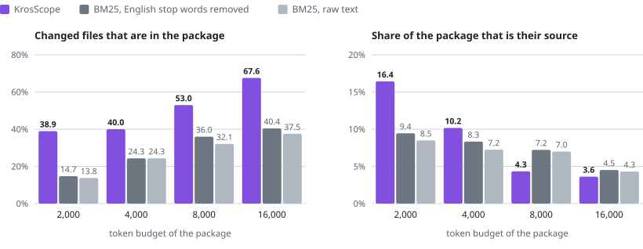
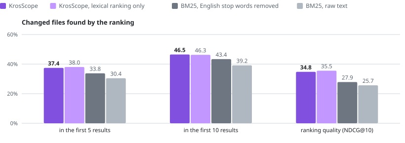
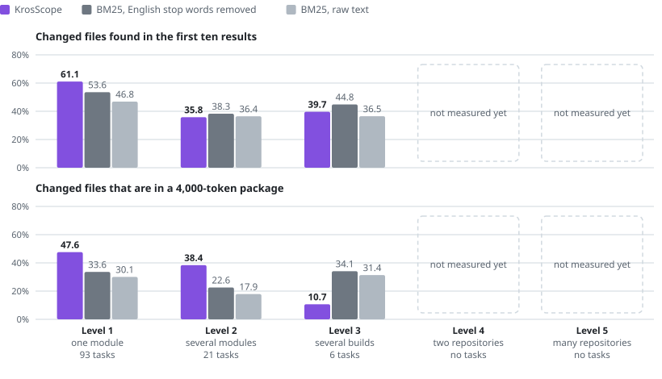
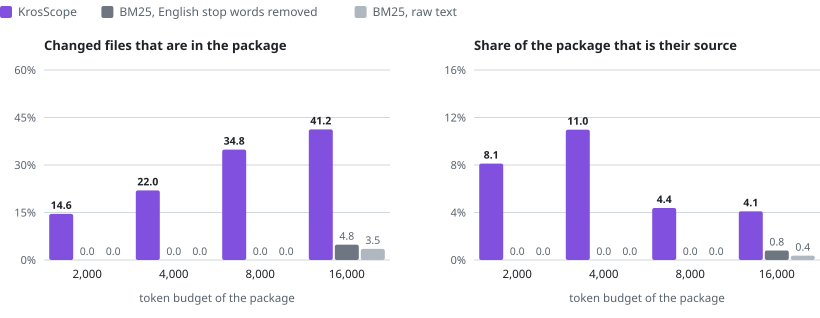
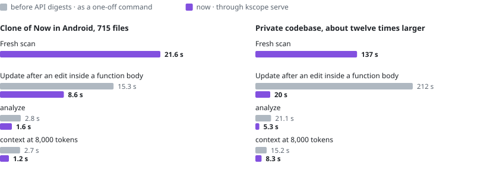
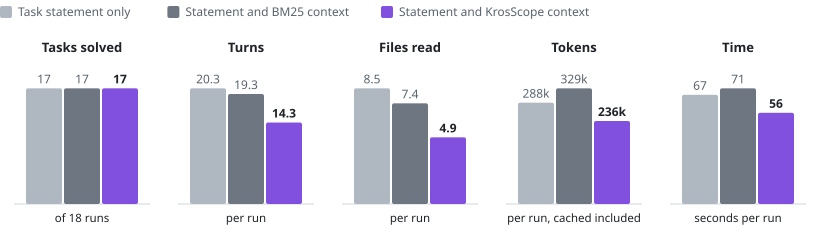

# Results

What was measured, on what data, and where KrosScope loses as well as where it wins. Each section has one chart,
the numbers behind it, and a link to the page with the method and every table.

KrosScope is ahead of both BM25 baselines on most task sets and metrics, and behind on some. Most clearly, at
8,000 and 16,000 tokens less of its package is source of the changed files.
[Where it is behind](#where-it-is-behind) and [Limits](#limits) list the rest.

| What a user gets | KrosScope | Better BM25 baseline | |
|---|---:|---:|---|
| Changed files in the first ten results | 46.5% | 43.4% | ahead |
| Changed files in a 2,000-token package | 38.9% | 14.7% | ahead |
| Changed files in a 16,000-token package | 67.6% | 40.4% | ahead |
| Share of a 2,000-token package that is their source | 16.4% | 9.4% | ahead |
| Share of a 16,000-token package that is their source | 3.6% | 4.5% | **behind** |
| Update after an edit inside a function body | 8.6 s | | 715 files |
| `analyze` through `kscope serve` | 1.6 s | | 715 files |

The first five rows are means over the 60 held-out tasks of two public repositories.

## Context: the right files within a token budget

<picture>
  <source media="(prefers-color-scheme: dark)" srcset="charts/context-budget.dark.svg">
  
</picture>

| Budget | Changed files in the package: KrosScope | BM25, English | BM25, raw | Share that is their source: KrosScope | BM25, English | BM25, raw | Ahead of both on both |
|---:|---:|---:|---:|---:|---:|---:|---|
| 2,000 | 0.3893 | 0.1474 | 0.1377 | 0.1642 | 0.0945 | 0.0849 | yes |
| 4,000 | 0.4002 | 0.2432 | 0.2432 | 0.1017 | 0.0834 | 0.0724 | yes |
| 8,000 | 0.5297 | 0.3599 | 0.3210 | 0.0434 | 0.0722 | 0.0700 | **no**: behind on share |
| 16,000 | 0.6758 | 0.4043 | 0.3752 | 0.0362 | 0.0452 | 0.0431 | **no**: behind on share |

A 2,000-token package holds about as many of the changed files as a BM25 package of 16,000 tokens. At 8,000
tokens and above the packages hold more of the files but spend more of their tokens elsewhere. Pooled test
half, 60 tasks. Full results: [real-repository benchmark](real-repositories.md).

## Localization: finding the files

<picture>
  <source media="(prefers-color-scheme: dark)" srcset="charts/localization.dark.svg">
  
</picture>

| Method | Recall@5 | Recall@10 | NDCG@10 |
|---|---:|---:|---:|
| KrosScope | 0.3744 | 0.4650 | 0.3476 |
| KrosScope, lexical ranking only | 0.3802 | 0.4627 | 0.3553 |
| BM25, English stop words removed | 0.3377 | 0.4335 | 0.2785 |
| BM25, raw text | 0.3043 | 0.3918 | 0.2567 |

KrosScope beats both baselines in five of six task sets and loses recall in one, the test half of the
KotlinConf app. Its graph and history signals have not been shown to add to its own lexical ranking, which is
level with the full ranking here. Pooled test half, 60 tasks. Full results:
[real-repository benchmark](real-repositories.md).

## Task level: how far a change reaches

<picture>
  <source media="(prefers-color-scheme: dark)" srcset="charts/levels.dark.svg">
  
</picture>

KrosScope leads on changes inside one module. On changes across several modules its ranking falls behind
BM25, while its packages still hold more of the files. On the six tasks that cross a build boundary it loses, and
no real change across repositories has been measured. All 120 tasks. Numbers and method:
[results by task level](task-levels.md).

## On its own repository

<picture>
  <source media="(prefers-color-scheme: dark)" srcset="charts/self-context-budget.dark.svg">
  
</picture>

| | KrosScope | Better BM25 baseline |
|---|---:|---:|
| Changed files in the first ten results | 27.2% | 5.9% |
| Changed files in a 4,000-token package | 22.0% | 0.0% |
| Changed files in a 16,000-token package | 41.2% | 4.8% |
| Fresh scan, median | 57.9 s | |
| Update to the next commit, median | 28.4 s | |

The same benchmark on the history of this repository, 19 tasks. KrosScope is ahead of both baselines in both
halves, but they return the repository's documentation instead of its source, so the margin flatters it. Full
results: [self benchmark](self-benchmark.md).

## Time

<picture>
  <source media="(prefers-color-scheme: dark)" srcset="charts/speed.dark.svg">
  
</picture>

| Operation | Now in Android clone, 715 files | Private codebase, about twelve times larger |
|---|---:|---:|
| Fresh scan | 21.6 s | 137 s |
| Update after an edit inside a function body | 8.6 s (was 15.3 s) | 20 s (was 212 s) |
| `analyze`, through a server | 1.6 s (2.8 s without) | 5.3 s (21.1 s without) |
| `context` at 8,000 tokens, through a server | 1.2 s (2.7 s without) | 8.3 s (15.2 s without) |

Single runs on one shared Windows machine, where repeated runs differed by up to a factor of two. The private
codebase cannot be shared, so its column cannot be reproduced. Full results: [performance](performance.md).

## Coding agent

<picture>
  <source media="(prefers-color-scheme: dark)" srcset="charts/agent-pilot.dark.svg">
  
</picture>

| The agent is given | Solved | Turns | Files read | Tokens | Reported cost | Time |
|---|---:|---:|---:|---:|---:|---:|
| The task statement | 17/18 | 20.3 | 8.5 | 287,682 | $0.180 | 67 s |
| The statement and BM25 context | 17/18 | 19.3 | 7.4 | 328,623 | $0.218 | 71 s |
| The statement and KrosScope context | 17/18 | 14.3 | 4.9 | 235,880 | $0.176 | 56 s |

A pilot, not a result: 54 runs on six small tasks of the reference workspace, which the model solves unaided.
It cannot show that context helps an agent succeed, and with three repeats per task no difference is
statistically established. Full results: [coding-agent pilot](agent-pilot.md).

A second pilot with Codex at a high effort setting, 54 runs, also solved every task in every arm and saved neither tokens nor time; see the [second pilot](agent-pilot.md#second-pilot-codex).

## Correctness of the links

On the reference workspace, which was built to contain every kind of link KrosScope claims, precision is 1.00
in all 23 classes and recall is 1.00 in all but one (Kotlin calls Java, 0.94 without `--trust-build`). On six
sampled files of the two public repositories, all 306 `exact` links to declarations of the workspace were
correct, and 16 of the 183 such references in the three Now in Android files were missing. Full results: [support matrix](../support-matrix.md) and
[real-repository validation](real-repository-validation.md).

## Where it is behind

- How much of a large package (8,000 tokens and more) is source of the changed files.
- The ranking for changes across several modules.
- Both ranking and packages for changes across several builds, measured on six tasks.
- Recall in one of the six task sets, the held-out half of the KotlinConf app.
- Its graph and history signals have not been shown to add to its own lexical ranking.
- On the reference workspace, test selection and symbol recall miss their targets, and the context gate fails at
  8,000 tokens on token precision.

## Limits

- **Library code.** Without `--trust-build`, references into libraries stay unresolved; on the two public
  repositories that was more than half of the stored links.
- **Several repositories are new.** Links between repositories are scored against gold data on a small constructed
  fixture only ([support matrix](../support-matrix.md#links-between-repositories)), and no real task across
  repositories has been measured.
- **Updates after a signature change.** An edit inside a function body is cheap; a changed signature still
  re-analyses the code that depends on it.
- **Kotlin and Java only**, and no dependency-injection graphs or Compose navigation routes
  ([full list](../support-matrix.md#not-supported-or-not-analysed)).
- **No benefit to an agent on small tasks.** In two pilots on small tasks inside one small repository, an agent given
  KrosScope context did not succeed more often, and Codex spent as many tokens and as much time. Large applications
  and work across repositories are what KrosScope is aimed at, and that has not been measured.
- **Non-ASCII task text on Windows.** With JDK 17, the command line can replace non-ASCII characters; pass such text
  with `--task-file`.

## All pages

| Page | Data | Outcome |
|---|---|---|
| [Real-repository benchmark](real-repositories.md) | 120 tasks from the commits of two public repositories | Ahead at small budgets, behind on token precision at large ones; ranking ahead in five of six task sets |
| [Results by task level](task-levels.md) | The same 120 tasks, grouped by how far the change reaches | Ahead inside one module, mixed across modules, behind across builds; across repositories not measured on real commits |
| [Self benchmark](self-benchmark.md) | 19 tasks from the commits of this repository | Ahead of both baselines in both halves, which return documentation |
| [Real-repository validation](real-repository-validation.md) | The two repositories at pinned commits | No scan failed; over half of the links stay unresolved without `--trust-build` |
| [Performance](performance.md) | A public clone and a private codebase, single runs | Body edits and served queries are fast; a signature change is still slow |
| [Coding-agent pilot](agent-pilot.md) | 54 runs on six tasks of the reference workspace | At its ceiling: equal success, less exploration, nothing established |

## Reading the numbers

- **Changed files**, or **gold**, are the answer key of a task: the source files that the real commit changed.
  The task statement is the commit's message with paths removed.
- **Recall@5 and recall@10** are the share of the changed files among the first five or ten results.
  **NDCG@10** scores the order of the first ten from 0 to 1.
- **Gold recall** of a context package is the share of the changed files that appear in it with source.
  **Token precision** is the share of its tokens that is source from those files, so it is small for every
  method.
- **BM25** is a standard text-ranking function. One baseline ranks the raw text of the files, the other removes
  English stop words first.
- **Ahead of both** means strictly better than both baselines on that task set and metric; a tie does not
  count. The [method](../benchmark.md) also compares the full ranking with KrosScope's own lexical-only ranking.
- **Development and test halves** are split by time. The code is frozen before the test half is scored, once
  per freeze; the frozen manifests are in [`benchmark/freezes`](../../benchmark/freezes/README.md).

Measurements were taken on Windows 11 with JDK 17 unless a page says otherwise. The
[method](../benchmark.md) defines the metrics and the policy, the
[development guide](../development.md#running-the-benchmarks) has the commands, and the charts are drawn by
[`charts/charts.py`](charts/charts.py) from [`charts/data.json`](charts/data.json).
