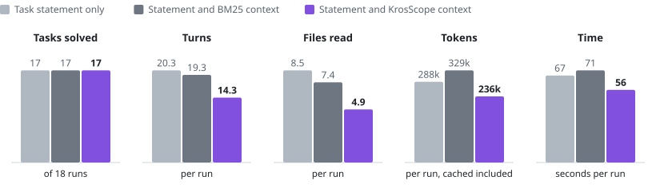

# Coding-agent pilot

This page reports a pilot in which a coding agent worked on six small tasks with and without
KrosScope context.

## In short

- **This is a pilot, not a result: 54 runs on six small tasks.** Task success was the same in all
  three arms, 17 of 18.
- **Fewer turns and files read.** With KrosScope context the agent needed fewer turns, 14.3 against
  20.3, and read fewer files, 4.9 against 8.5.
- **Cost did not fall.** The reported cost was unchanged, at a ratio of 0.99 to the statement-only
  arm.
- **Nothing here is statistically established.** Three repeats per cell leave a large spread.
- **Limits.** The six tasks come from the project's own reference workspace, so the pilot is not
  evidence about real repositories.
- **A second pilot, with Codex, agrees.** All 54 runs solved their task in every arm, and KrosScope context saved neither tokens nor time; see [Second pilot: Codex](#second-pilot-codex).

<picture>
  <source media="(prefers-color-scheme: dark)" srcset="charts/agent-pilot.dark.svg">
  
</picture>

## Setup

| | |
|---|---|
| Date | 2026-10-07 |
| Agent | The `claude` command-line agent, headless, model alias `sonnet` |
| Agent tools | Read, search and edit files. No shell: the agent cannot compile or run tests |
| Tasks | Six task packages of the reference workspace, each with hidden tests and a validated reference patch |
| Arms | A: task statement only. B: statement plus BM25 whole-file context. C: statement plus KrosScope context |
| Context budget | 4,000 tokens (`o200k_base`), the same for B and C |
| Runs | 6 tasks x 3 arms x 3 repeats = 54, all completed, none failed at agent level |
| Limits per run | 15 minutes; no run reached it |
| Implementation | Commit `f5becc6` |

How a run works:

- Each run works in an isolated copy of the workspace with a fresh Git history and without gold data,
  reference patch or hidden tests.
- When the agent ends, the hidden tests are copied in and run.
- A run succeeds only if the tests that must start passing do, and no previously passing test
  breaks.

The harness and its commands are described in [benchmark.md](../benchmark.md#agent-benchmark).

## Results

Means over the 18 runs of each arm:

| Arm | Success | Turns | Files read | Total tokens | Uncached tokens | Reported cost | Wall time |
|---|---:|---:|---:|---:|---:|---:|---:|
| A, statement only | 17/18 | 20.3 | 8.5 | 287,682 | 24,233 | $0.180 | 67 s |
| B, BM25 context | 17/18 | 19.3 | 7.4 | 328,623 | 29,779 | $0.218 | 71 s |
| C, KrosScope context | 17/18 | 14.3 | 4.9 | 235,880 | 25,805 | $0.176 | 56 s |

Ratios to arm A, as geometric means over the six tasks:

| Arm | Total tokens | Reported cost |
|---|---:|---:|
| B, BM25 context | 0.94 | 1.14 |
| C, KrosScope context | 0.74 | 0.99 |

The injected context contained 28% of the gold files in arm B and 63% in arm C.

What the pilot shows, and what it does not:

- **No difference in success.** Every arm solved 17 of 18 runs, and the one failure in each arm was
  on the same task, T05. The model solves these tasks unaided, so the pilot is at the ceiling and
  cannot show a success benefit in either direction.
- **Less exploration with KrosScope context.** Turns fell from 20.3 to 14.3 and files read from 8.5
  to 4.9. Total tokens were lower in four of six tasks, about equal in one (T01) and higher in one
  (T04).
- **Cost did not fall.** Most of an agent's tokens are cache reads, which are cheap, and the injected
  context adds uncached input. Reported cost was the same as without context (ratio 0.99).
- **BM25 context cost more.** At the same budget it lowered total tokens slightly (0.94) and raised
  reported cost (1.14). It helped most on T07 and hurt on T04 and T05.
- **The spread is large.** Three repeats of one task in one arm ranged from 219,000 to 779,000
  tokens. With three repeats per cell no difference between arms is statistically established.

## Limits

- The six tasks come from the project's own reference workspace, which has 154 files and against
  which KrosScope was developed. Exploring it is cheap, which limits what context can save, and it
  is not evidence about real repositories.
- One agent, one model, one budget, three repeats. No shell, so the agent could not check its work.
- Tokens and cost are the agent's own reported figures.
- Under the [benchmark policy](../benchmark.md), a token figure is reported only beside task
  success. Here success is equal at the ceiling; whether context helps on tasks the model cannot
  already solve is unmeasured.

## Second pilot: Codex

The same six tasks, arms and budget, run with the `codex` adapter: model `gpt-6.1-sol` at reasoning effort
`xhigh`, three repeats, 54 runs, on 9 October 2026. Unlike the first pilot, the agent has a shell, so the two
pilots cannot be compared with each other.

| The agent is given | Solved | Tokens per run | Time per run | Tool calls | Files read |
|---|---:|---:|---:|---:|---:|
| The task statement | 18/18 | 1,300,379 | 330 s | 23.3 | 20.3 |
| The statement and BM25 context | 18/18 | 1,347,500 | 361 s | 18.9 | 18.0 |
| The statement and KrosScope context | 18/18 | 1,370,137 | 342 s | 22.2 | 18.0 |

By [task level](task-levels.md), the statement alone against KrosScope context:

| Level | Tasks | Runs per arm | Tokens per run | Time per run |
|---|---|---:|---|---|
| 1, one module | T04, T05, T06, T07 | 12 | 1,037,804 against 1,085,916 | 283 s against 286 s |
| 2, several modules | T01, T02 | 6 | 1,825,529 against 1,938,579 | 422 s against 454 s |

- **No difference in success.** Every run solved its task, so this pilot is at the ceiling as well.
- **No saving that stands out from the spread.** Paired by task, tokens with KrosScope context are 0.91 of the
  statement-only arm and time is 0.94. Two small tasks account for that (T04 at 0.50, T07 at 0.71), and two
  tasks cost more (T01 at 1.10, T05 at 1.52). Three repeats of one task in one arm ranged from 1.66 to 2.83
  million tokens.
- **Harder tasks were not helped more.** Level 2 tasks took about 75% more tokens and 50% more time than
  level 1, with or without context.
- **What this says.** On small tasks inside one small repository, a 4,000-token package gives a capable agent
  with a shell no measurable benefit. It is 0.3% of what the agent spends, and the workspace has 154 files, so
  finding the files is not the hard part. Whether KrosScope helps on large applications or across
  repositories, which is what it is aimed at, has not been measured.

Limits of this pilot: one model at one effort setting; tokens are the agent's own figures, about 93% of them
cache reads, and this agent reports no cost; the agent ran with the account's own Codex configuration, the
same in every arm, which included global instructions, one tool server provided by a plugin and one feature
that Codex labels as under development.

## Generated report

The tables below are the harness's aggregate report for this run. "Gold recall" is the share of
gold files the agent ended up changing; "Extra files" is the mean number of files it changed that
are not gold.

### Arms

- A: statement only
- B: statement and BM25 whole-file context
- C: statement and KrosScope context

### Per arm, all tasks

| Arm | Runs | Success | Tokens | Uncached | Cost USD | Turns | Tool calls | Context tokens | Context recall | Gold recall |
|---|---|---|---|---|---|---|---|---|---|---|
| A | 18/18 | 17/18 | 287,682 | 24,233 | 0.180 | 20.3 | 19.3 | 0 | - | 100% |
| B | 18/18 | 17/18 | 328,623 | 29,779 | 0.218 | 19.3 | 18.3 | 4,000 | 28% | 99% |
| C | 18/18 | 17/18 | 235,880 | 25,805 | 0.176 | 14.3 | 13.3 | 3,990 | 63% | 100% |

| Arm | Tokens per solved task | Cost per solved task | Token ratio to A | Cost ratio to A | Cache hit |
|---|---|---|---|---|---|
| A | 304,605 | 0.191 | - | - | 92% |
| B | 347,954 | 0.230 | 0.94 | 1.14 | 88% |
| C | 249,755 | 0.187 | 0.74 | 0.99 | 87% |

### Per task

Results for each task and arm

| Task | Arm | Runs | Success | Tokens | Cost USD | Turns | Context tokens | Context recall | Gold recall | Extra files |
|---|---|---|---|---|---|---|---|---|---|---|
| T01 Optional reminder time on tasks | A | 3/3 | 3/3 | 505,668 | 0.297 | 33.3 | 0 | - | 100% | 0.0 |
|  | B | 3/3 | 3/3 | 507,357 | 0.291 | 31.0 | 4,000 | 0% | 92% | 0.3 |
|  | C | 3/3 | 3/3 | 516,788 | 0.292 | 33.0 | 3,996 | 25% | 100% | 0.0 |
| T02 Report the client version in every sync request | A | 3/3 | 3/3 | 273,314 | 0.159 | 23.3 | 0 | - | 100% | 0.0 |
|  | B | 3/3 | 3/3 | 182,470 | 0.147 | 14.3 | 4,000 | 40% | 100% | 0.0 |
|  | C | 3/3 | 3/3 | 119,149 | 0.123 | 8.7 | 3,985 | 80% | 100% | 0.0 |
| T04 Rename the task list title string | A | 3/3 | 3/3 | 91,928 | 0.076 | 11.0 | 0 | - | 100% | 0.0 |
|  | B | 3/3 | 3/3 | 164,037 | 0.127 | 13.0 | 4,000 | 0% | 100% | 0.0 |
|  | C | 3/3 | 3/3 | 103,022 | 0.102 | 8.3 | 3,984 | 50% | 100% | 0.0 |
| T05 Format due dates in the device time zone | A | 3/3 | 2/3 | 517,633 | 0.315 | 28.7 | 0 | - | 100% | 1.0 |
|  | B | 3/3 | 2/3 | 883,452 | 0.509 | 40.7 | 3,999 | 0% | 100% | 2.3 |
|  | C | 3/3 | 2/3 | 455,221 | 0.313 | 20.0 | 3,997 | 100% | 100% | 1.3 |
| T06 Completed tasks count towards the demo task limit | A | 3/3 | 3/3 | 209,997 | 0.150 | 17.0 | 0 | - | 100% | 0.0 |
|  | B | 3/3 | 3/3 | 185,855 | 0.160 | 14.3 | 4,000 | 25% | 100% | 0.0 |
|  | C | 3/3 | 3/3 | 156,236 | 0.147 | 13.0 | 3,994 | 25% | 100% | 0.0 |
| T07 CSV export shows 1970 for tasks without a due date | A | 3/3 | 3/3 | 127,555 | 0.085 | 8.7 | 0 | - | 100% | 0.0 |
|  | B | 3/3 | 3/3 | 48,569 | 0.072 | 2.3 | 4,000 | 100% | 100% | 0.0 |
|  | C | 3/3 | 3/3 | 64,862 | 0.082 | 3.0 | 3,985 | 100% | 100% | 0.0 |

### Failed runs

None.

### Missing runs

None.

### Runs with environment warnings

None.

Notes on the generated report

- Success is pass@1 over completed runs, decided by hidden fail-to-pass and pass-to-pass tests.
- A failed run is an agent-level failure (authentication, timeout, non-zero exit, agent error) and is
  excluded from success.
- Tokens count input, cache-creation, cache-read and output tokens as the agent reports them; cost is
  the agent's reported cost.
- Ratios to A are geometric means over tasks.

