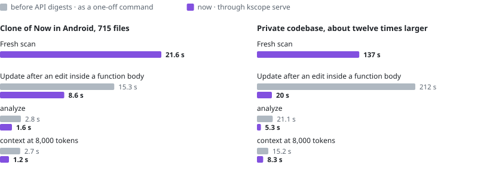

# Performance

How long `kscope` takes on a public project and on a private one, before and after a set of optimisations.

## In short

- Context compilation at 8,000 and 16,000 tokens no longer dominates a query. This is the larger result.
- Scanning did not get faster on the public clone, which is the smaller result: a fresh scan took 21.3 s before and
  21.6 s after.
- An update after one changed file was still slow after those optimisations. A later change made it fast for the
  most common kind of edit, and [its section](#update-after-an-edit-inside-a-function-body) has the figures.
- Queries are faster through a server; see [queries through a server](#queries-through-a-server).
- The output of every command was identical before and after each optimisation.
- Every figure is a single run on one shared Windows machine, and the private codebase cannot be reproduced here.

<picture>
  <source media="(prefers-color-scheme: dark)" srcset="charts/speed.dark.svg">
  
</picture>

## What was measured

| | |
|---|---|
| Workspaces | A clone of Now in Android (715 tracked files, of which 310 are Kotlin; see [real-repository validation](real-repository-validation.md#repositories)) and a private Kotlin codebase described only as roughly twelve times larger |
| Operations | A fresh scan, a scan with nothing changed, an update after one changed file, `analyze`, and `context` at 2,000, 4,000, 8,000 and 16,000 tokens and with no budget |
| Machine | One Windows machine that was shared with other builds |
| Runs | One run per figure |
| Correctness | Output was byte-identical before and after each optimisation. The index is identical for 1, 3 and 4 analyzer workers. `scan --verify` matches a clean rebuild |

The commands are in [cli.md](../cli.md).

## Public clone: Now in Android

| Operation | Before | After |
|---|---:|---:|
| Fresh scan | 21.3 s | 21.6 s |
| Scan with nothing changed | not recorded | 1.5 s |
| Update after one changed file | 10.3 s | 11.0 s |
| `analyze` | 3.8 s | 2.4 s |
| `context` at 2,000 and 4,000 tokens | 2.8 s | 1.9 s |
| `context` at 8,000 tokens | 60.1 s | 2.4 s |
| `context` at 16,000 tokens | 161.0 s | 2.9 s |
| `context` with no budget | 2.9 s | 2.4 s |

The stages of the fresh scan after the changes: discovery 0.3 s, build model 2.4 s, fact production 17.0 s,
linking 0.5 s and search index 0.4 s. Fact production, which includes the analysis of the Kotlin and Java
sources, is most of the scan.

A fresh scan and an update took as long after the changes as before. The two differences, 21.3 s against 21.6 s
and 10.3 s against 11.0 s, are within the variation of single runs on a shared machine. The earlier
[validation](real-repository-validation.md#default-scan) saw repeated runs of the same build differ by up to a
factor of two.

## Private codebase, roughly twelve times larger than Now in Android

This codebase is not public, so these figures cannot be reproduced from this repository. They are here because
they show how the costs grow with size.

| Operation | Before | After |
|---|---:|---:|
| Fresh scan | 231 s | 137 s, with three analyzer workers |
| Update after one changed file | 158 s | 102 s |
| `analyze` | 102 s | 17 s |
| `context` at 2,000 and 4,000 tokens | 78 s | 11 s |
| `context` at 8,000 tokens | 713 s | 14 s |
| `context` at 16,000 tokens | more than 15 minutes (stopped) | 16 s |

## What changed

Six changes account for the differences. They were measured together, and the figures above are not attributed
change by change.

- **Incremental token accounting in context selection.** Selecting context under a budget counts tokens
  incrementally. The selection used at 8,000 tokens and above is where the time went: the
  [real-repository benchmark](real-repositories.md#small-budget-packing-realrepos-v2) found it to be the slow
  part of context scoring.
- **Set membership in graph ranking.** Graph ranking tests membership with sets.
- **One graph decode per command.** A query decodes the index once and keeps the result for the rest of the
  command ([query cost](../architecture.md#query-cost)).
- **Bounded parallel analyzer workers.** A scan with enough source shares its source sets over several worker
  JVMs, limited by `KSCOPE_WORKERS` and by memory ([cli.md](../cli.md#environment-variables)).
- **A shared serializer for the canonical sort key.** The store computes the key with one serializer for all
  facts and sorts on it ([query cost](../architecture.md#query-cost)).
- **Array-based ranking.** Ranking runs on arrays over the same neighbourhood, with the same sums in the same
  order.

## Update after an edit inside a function body

Measured later than the tables above, with the build before and the build after
[API digests](../decisions/0014-api-digests.md), one after the other on the same machine. The edit is the same in
both: three statements inserted into the body of one function.

| Workspace | | Work units redone | Source sets analysed | `scan` |
|---|---|---:|---:|---:|
| Now in Android clone, a repository class in `core/data` | before | 48 | 37 | 15.3 s |
| | after | 12 | 1 | 8.6 s |
| Private codebase, a file most of the code depends on | before | 51 | 40 | 212 s |
| | after | 12 | 1 | 20 s |

`scan --verify` reported after each of the two edits that the incremental index matches a clean rebuild.

The first scan with the new build analyses everything once, because the fingerprints are built differently: 19.7 s
on the public clone and 201 s on the private codebase in these runs.

The machine was busier than for the tables above, which is why the "before" figures here are higher than the update
times there. Compare each "after" with its own "before".

## Queries through a server

[`kscope serve`](../cli.md#serve) keeps the index and the decoded graph of a workspace in memory. The same commands,
with and without a server running, one after the other on the same machine; the output was byte for byte the same:

| Workspace | Command | Without a server | Through a server |
|---|---|---:|---:|
| Now in Android clone | `analyze` of a task | 2.8 s | 1.6 s |
| | `context` at 8,000 tokens | 2.7 s | 1.2 s |
| | `symbol` of a name | 1.5 s | 0.7 s |
| | `impact` of a name | 1.6 s | 1.1 s |
| | `info` | 0.9 s | 0.6 s |
| Private codebase | `analyze` of a task | 21.1 s | 6.6 s, then 5.3 s |
| | `context` at 8,000 tokens | 15.2 s | 8.3 s |
| | `info` | 2.1 s | 1.7 s |

About 0.6 s of every figure in the last column is the start of the `kscope` process that asks. What is left on the
private codebase is the work of the query itself, mostly token counting.

## What remains slow, and why

- **An update re-analyses the dependent source sets when something they can see changed.**
  - An edit to a signature, an expression body, a property initializer or any Java file still costs what the tables
    at the top show: 11.0 s of the 21.6 s a fresh scan takes on the public clone and 102 s of the 137 s on the
    private codebase.
  - An edit inside a function body no longer does; see the section above.
  - [Real-repository validation](real-repository-validation.md#incremental-behaviour) shows the earlier behaviour.
- **Each analyzer worker has a fixed start-up cost.** A scan starts its worker JVMs when source sets have to be
  analysed and ends them when it is done ([cli.md](../cli.md#kotlin-and-java-analysis)), so every scan with
  source to analyse pays that start-up.
- **Token counting dominates what is left of `analyze` and `context` on the large codebase**, which is the 17 s
  and the 11 to 16 s above.

## Limits

- Every figure is a single run. Differences of a few percent are noise, and so are the small increases for a
  fresh scan and an update on the public clone.
- One shared Windows machine. Nothing was measured on Linux or macOS, and the load from other builds was not
  controlled.
- The private codebase cannot be shared, so its figures are not reproducible here, and it is described only as
  roughly twelve times larger than the public clone.
- The task statement used for `analyze` and `context`, and the file changed for the update, are not recorded
  on this page. Query time and update time depend on both.
- These are wall-clock times of whole commands. They are not a distribution of query latency, and they say
  nothing about memory.

## Reproducing

Clone Now in Android at the commit in [real-repository validation](real-repository-validation.md#repositories),
build the distribution as described in the [development guide](../development.md#build-and-run-the-cli), and time
the commands from the root of the clone:

```shell
kscope scan --rebuild
kscope scan
kscope analyze "<task>"
kscope context "<task>" --budget 8000 --format markdown
```

Change one source file and run `kscope scan` again to time an update. `kscope scan --verify` compares an
incremental result with a clean rebuild. Set `KSCOPE_WORKERS` to fix the number of analyzer workers.
