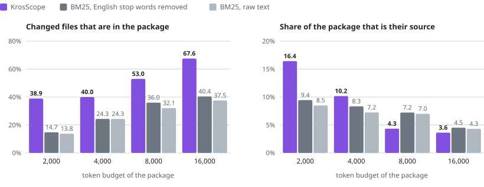
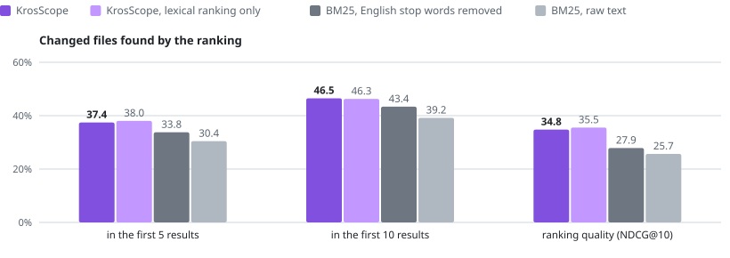

# Real-repository benchmark

This page compares KrosScope's localization and context compilation with two BM25 baselines on 120
tasks from two public repositories.

## In short

- **Not ahead of both baselines everywhere** ([Tier 1](../benchmark.md#analyzer-benchmark)). All 120 tasks were
  measured; the run is complete and valid.
- **Localization** beats both BM25 baselines in five of six groups and loses recall in one,
  kotlinconf-app TEST.
- **Context compilation, as first measured,** loses token precision to both BM25 baselines at every
  budget in every group.
- **Small-budget packing** is a later change, measured under a second freeze and described in
  [Small-budget packing](#small-budget-packing-realrepos-v2). It reverses that at 2000 and 4000
  tokens on the test split in five of six cells. Budgets of 8000 and 16000 are unchanged and still
  lose precision, so KrosScope is still not ahead everywhere.
- **Reported as measured.** No threshold or gold set was changed after scoring.
- **Limits.** Two repositories, 30 tasks per group. Coding-agent task success has not been measured.
  See [Limitations](#limitations).

<picture>
  <source media="(prefers-color-scheme: dark)" srcset="charts/context-budget.dark.svg">
  
</picture>

<picture>
  <source media="(prefers-color-scheme: dark)" srcset="charts/localization.dark.svg">
  
</picture>

## How it was measured

The freeze was written before any task was scored, the development split ran before the test split,
and the test split was scored once. Commands and protocol: [benchmark.md](../benchmark.md).

Date, machine, implementation and freeze manifest

- **Date and machine:** measured on 2026-10-06 on Windows 11, JDK 17, 16 cores, 31 GB, with JTokkit
  `o200k_base`.
- **Implementation:** commit `cd50e24` plus the working-tree files identified by exact hash in
  [realrepos-v1](../../benchmark/freezes/realrepos-v1.json).
- **Freeze manifest SHA-256:** `37e33469d9d191b82f91971ec609db0cf00b3fcd6cb2017f1e56ff210a6983b4`.

## Corpus

Two public repositories, pinned: `nowinandroid` at `a49ed253d75e61a2b6ab80a8da677b57437b08eb`
and `kotlinconf-app` at `248474dd27e1f84dadf309618a4e0fa82d7e9bfb`.

| | kotlinconf-app | nowinandroid |
|---|---:|---:|
| Candidate commits (most recent, non-merge) | 400 | 400 |
| Eligible | 244 | 184 |
| Selected (newest 60) | 60 | 60 |
| Development / test, chronological | 30 / 30 | 30 / 30 |

A commit is eligible when it changes one to eight source files that exist at its parent and is
not a merge, a bot commit, a pure rename, a formatting-only or a whitespace-only change.

How a task is built:

- The task statement is the commit message with paths, file names and pull-request numbers removed.
- Gold is the set of changed source files that exist at the parent; added files are not gold.
- For every task the index is built from a scratch checkout of the parent commit, so the index and
  the history signals contain nothing from the commit itself or from later commits.
- The original checkouts are never modified; their HEAD and working tree were unchanged after the
  run.

## Localization

Macro averages over tasks. Tier 1 requires KrosScope full to strictly beat both BM25 baselines
on R@5, R@10 and NDCG@10.

| Group | Method | R@5 | R@10 | NDCG@10 |
|---|---|---:|---:|---:|
| Pooled DEV (60) | BM25 raw | 0.4004 | 0.4982 | 0.3575 |
| Pooled DEV (60) | BM25 English | 0.4546 | 0.5756 | 0.4222 |
| Pooled DEV (60) | Lexical only | 0.4696 | 0.5927 | 0.4344 |
| Pooled DEV (60) | KrosScope full | 0.4946 | 0.6468 | 0.4488 |
| Pooled TEST (60) | BM25 raw | 0.3043 | 0.3918 | 0.2567 |
| Pooled TEST (60) | BM25 English | 0.3377 | 0.4335 | 0.2785 |
| Pooled TEST (60) | Lexical only | 0.3802 | 0.4627 | 0.3553 |
| Pooled TEST (60) | KrosScope full | 0.3744 | 0.4650 | 0.3476 |

| Group | Full vs best BM25: R@5 | R@10 | NDCG@10 | Localization Tier 1 |
|---|---|---|---|---|
| kotlinconf-app DEV | 0.5187 vs 0.4520 | 0.7262 vs 0.6123 | 0.4878 vs 0.4485 | pass |
| nowinandroid DEV | 0.4706 vs 0.4571 | 0.5675 vs 0.5389 | 0.4097 vs 0.3960 | pass |
| Pooled DEV | 0.4946 vs 0.4546 | 0.6468 vs 0.5756 | 0.4488 vs 0.4222 | pass |
| kotlinconf-app TEST | 0.3556 vs 0.3742 | 0.4484 vs 0.4659 | 0.3157 vs 0.2912 | **fail** (R@5, R@10) |
| nowinandroid TEST | 0.3933 vs 0.3011 | 0.4817 vs 0.4011 | 0.3796 vs 0.2657 | pass |
| Pooled TEST | 0.3744 vs 0.3377 | 0.4650 vs 0.4335 | 0.3476 vs 0.2785 | pass |

Tier 2, full against lexical only, paired bootstrap 95% intervals:

- **Pooled DEV:** a significant win on R@10 and inconclusive on R@5 and NDCG@10.
- **Pooled TEST:** inconclusive on all three.
- **kotlinconf-app TEST:** a significant loss on NDCG@10.

On the test split the graph, projection and history signals add nothing measurable over the lexical
ranker.

## Context compilation

Gold recall / token precision, macro averages. Recall counts gold files with source content in
the package. Precision is deduplicated source tokens from gold files divided by all tokens of
the rendered package. Tier 1 requires the full compiler to strictly beat both BM25 baselines on
both metrics.

| Group | Budget | Full compiler | BM25 raw | BM25 English | Lexical compiler | Tier 1 |
|---|---:|---|---|---|---|---|
| Pooled DEV | 2000 | 0.1579 / 0.0394 | 0.2341 / 0.1803 | 0.3129 / 0.2451 | 0.2121 / 0.0383 | FAIL |
| Pooled DEV | 4000 | 0.2794 / 0.0433 | 0.3171 / 0.1615 | 0.3903 / 0.1969 | 0.3099 / 0.0542 | FAIL |
| Pooled DEV | 8000 | 0.4026 / 0.0347 | 0.4194 / 0.1135 | 0.4700 / 0.1294 | 0.4387 / 0.0494 | FAIL |
| Pooled DEV | 16000 | 0.6323 / 0.0393 | 0.5014 / 0.0719 | 0.5895 / 0.0826 | 0.6810 / 0.0542 | FAIL |
| Pooled TEST | 2000 | 0.3031 / 0.0278 | 0.1377 / 0.0849 | 0.1474 / 0.0945 | 0.2906 / 0.0459 | FAIL |
| Pooled TEST | 4000 | 0.3742 / 0.0364 | 0.2432 / 0.0724 | 0.2432 / 0.0834 | 0.3922 / 0.0444 | FAIL |
| Pooled TEST | 8000 | 0.5297 / 0.0434 | 0.3210 / 0.0700 | 0.3599 / 0.0722 | 0.5172 / 0.0535 | FAIL |
| Pooled TEST | 16000 | 0.6758 / 0.0362 | 0.3752 / 0.0431 | 0.4043 / 0.0452 | 0.5873 / 0.0430 | FAIL |

- **Token precision loses everywhere.** In all six groups and at all four budgets the full
  compiler's token precision is below both BM25 baselines.
  - The BM25 baselines pack whole top-ranked files. The compiler spends most of a small budget on
    signatures, outlines and maps, which earn no source-coverage credit.
  - At 2000 tokens on pooled TEST its packages hold 55 gold source tokens on average against 189
    for BM25 English.
- **Recall is split by split.** On DEV the full compiler loses recall at 2000, 4000 and 8000 and
  wins at 16000. On TEST it wins recall at every budget in both repositories.
- **Tier 2, full against the lexical compiler.** Pooled TEST: a significant recall win at 16000;
  significant precision losses at 2000, 8000 and 16000; the rest inconclusive. Pooled DEV:
  significant recall losses at 2000 and 16000 and significant precision losses at 4000, 8000 and
  16000.

## Small-budget packing (realrepos-v2)

The first measurement showed that at small budgets the compiler spent most of the package on
signatures, outlines and maps. One improvement attempt followed: below 8000 tokens the compiler
now packs raw source only, in rank order, as whole files and declarations.

Packages at 8000 tokens and above are byte-identical to the first measurement, which a test pins
over 48 packages.

How the change was evaluated, and a disclosure

How it was evaluated:

- Developed on the development split and the fixture's original statements only.
- The rule for keeping the change was written down before any measurement: no passing Tier 1 cell
  may fail, token precision must rise at 2000 and 4000 on both development sets, and recall must
  not drop. All three held.
- The implementation was then frozen as
  [realrepos-v2](../../benchmark/freezes/realrepos-v2.json), SHA-256
  `573b4d41030b6396999e5108a6e5390fa1d6565bc6246c0ca795dde5c83551ce`, and the test split was
  scored once at 2000 and 4000.
- Disclosure: the pooled test rows of the first measurement were already on this page while the
  change was developed. The packing rule was specified before those rows existed, and both
  development iterations were chosen on development evidence.

Test split, gold recall / token precision:

| Group | Budget | Full, first | Full, v2 | Lexical, v2 | BM25 raw | BM25 English | Tier 1 cell |
|---|---:|---|---|---|---|---|---|
| kotlinconf-app TEST | 2000 | 0.2694 / 0.0238 | 0.4103 / 0.1684 | 0.3964 / 0.1829 | 0.0964 / 0.0651 | 0.1075 / 0.0776 | pass |
| kotlinconf-app TEST | 4000 | 0.3833 / 0.0283 | 0.3853 / 0.0812 | 0.3651 / 0.1054 | 0.2742 / 0.0816 | 0.2603 / 0.0903 | **fail** (precision) |
| nowinandroid TEST | 2000 | 0.3367 / 0.0317 | 0.3683 / 0.1600 | 0.4017 / 0.1607 | 0.1789 / 0.1046 | 0.1872 / 0.1114 | pass |
| nowinandroid TEST | 4000 | 0.3650 / 0.0445 | 0.4150 / 0.1223 | 0.3900 / 0.1195 | 0.2122 / 0.0633 | 0.2261 / 0.0765 | pass |
| Pooled TEST | 2000 | 0.3031 / 0.0278 | 0.3893 / 0.1642 | 0.3990 / 0.1718 | 0.1377 / 0.0849 | 0.1474 / 0.0945 | pass |
| Pooled TEST | 4000 | 0.3742 / 0.0364 | 0.4002 / 0.1017 | 0.3775 / 0.1124 | 0.2432 / 0.0724 | 0.2432 / 0.0834 | pass |

Development split, gold recall / token precision:

| Group | Budget | Full, first | Full, v2 | BM25 raw | BM25 English | Tier 1 cell |
|---|---:|---|---|---|---|---|
| kotlinconf-app DEV | 2000 | 0.0944 / 0.0504 | 0.3325 / 0.1968 | 0.1722 / 0.1810 | 0.2853 / 0.2965 | **fail** (precision) |
| kotlinconf-app DEV | 4000 | 0.2667 / 0.0494 | 0.4603 / 0.2316 | 0.3111 / 0.2016 | 0.3909 / 0.2595 | **fail** (precision) |
| nowinandroid DEV | 2000 | 0.2214 / 0.0283 | 0.4040 / 0.1448 | 0.2960 / 0.1795 | 0.3405 / 0.1937 | **fail** (precision) |
| nowinandroid DEV | 4000 | 0.2921 / 0.0373 | 0.5048 / 0.1499 | 0.3230 / 0.1213 | 0.3897 / 0.1344 | pass |
| Pooled DEV | 2000 | 0.1579 / 0.0394 | 0.3683 / 0.1708 | 0.2341 / 0.1803 | 0.3129 / 0.2451 | **fail** (precision) |
| Pooled DEV | 4000 | 0.2794 / 0.0433 | 0.4825 / 0.1907 | 0.3171 / 0.1615 | 0.3903 / 0.1969 | **fail** (precision) |

What this shows:

- Token precision rose by a factor of 2.7 to 7.1 in every group at both budgets, and recall rose
  everywhere.
- On the test split the compiler now beats both baselines on both metrics in five of six cells.
  On the development split it beats them on recall everywhere but still trails BM25 English on
  precision in five of six cells.
- Against the lexical compiler the full compiler is inconclusive on pooled test at both budgets.
  It shows two significant precision losses: nowinandroid at 2000, by 0.0008, and kotlinconf-app
  at 4000.
- Recall is not monotonic in the budget: on kotlinconf-app test it is lower at 4000 than at 2000,
  because greedy whole-file packing can spend a larger budget on one large file.
- Scoring five methods at these two budgets took 2.5 seconds per task on average, against 361
  seconds for four budgets in the first measurement. The slow part is the selection used at 8000
  and above.
- Tier 1 still fails overall: precision at 8000 and 16000 in every group, precision in the cells
  marked above, and localization recall on kotlinconf-app test.

## Scan and update time

Per task, pooled over both repositories, measured while two benchmark processes ran
concurrently on a shared machine.

| Phase | DEV mean / median / p95 | TEST mean / median / p95 |
|---|---|---|
| Full scan at the parent | 16.9 s / 17.1 s / 20.0 s | 16.8 s / 17.6 s / 19.8 s |
| Incremental update to the commit | 9.0 s / 10.4 s / 13.3 s | 8.5 s / 9.1 s / 16.0 s |
| Context scoring, five methods at four budgets | 397 s / 359 s / 740 s | 361 s / 321 s / 636 s |

Verify mode ran on five tasks; in all five the incremental result equalled a clean rebuild, with
no differing ownership unit and no differing search document. No task failed and no gold file
was absent from a parent index.

## Limitations

- Two repositories, 30 tasks per group. Intervals are wide and most Tier 2 comparisons are
  inconclusive.
- Commit-derived gold is file-level only. Symbol and test targets are unmeasured, and files a
  change needed to read but did not modify are not gold.
- Commit messages are short and uneven as task statements. Eleven statements keep trailer lines
  or a commit hash, and one is a single word.
- Context was scored for five methods: the full and lexical compilers, both BM25 packers and
  path-order packing. Three further compiler ablations were left out because they made each task
  2.8 times slower. Localization was scored for all eight methods.
- Context scoring takes about six minutes per task and dominated the 13.6 process-hours of the
  run. This is benchmark time for twenty packages per task, not a query-latency distribution;
  the cost of a single compilation was not isolated.
- Timing was measured under concurrent load on a shared machine.
- These are localization and context-coverage measurements. Coding-agent task success has not
  been measured.

## Aggregate report

The remainder of this page is the generated aggregate report for every group, with all eight
localization methods, all budgets and the bootstrap intervals.

How to read the aggregate report, and the eligibility exclusions

- Tier 1: FAIL. Complete: true. Valid: true.
- Task statements, source content and paths remain outside this aggregate report.
- DEV and TEST remain separate. Pooled means weight commits equally, not repositories equally.
- Partial groups show available observations with explicit expected and missing counts; they cannot
  pass.
- Tier 1 strictly beats raw and English BM25; lexical-only paired intervals are nonblocking Tier 2.
- Commit-only gold has no symbol/test targets: both are UNMEASURED.
- Corpus counts sum snapshot observations, not unique repository files. Timing distributions count
  available samples.

Validation categories:

- kotlinconf-app eligibility exclusions: bot=8, no-parent-source-files=109, selection-limit=184,
  too-many-source-files=39
- nowinandroid eligibility exclusions: bot=49, formatting=6, no-parent-source-files=142,
  selection-limit=124, too-many-source-files=17, whitespace-only=2

## kotlinconf-app / DEV

Timing, localization and context tables of this group (66 rows)

Expected 30; recorded 30; measured 30; missing 0; failed 0; rejected 0.
Tier 1 FAIL; complete true; valid true; partial false.
Failures: 
Failure phases: 
Gold files absent from the parent index (counted as misses): 0 in 0 tasks.

| Timing | Samples | Mean ms | Median ms | p95 ms |
|---|---|---|---|---|
| FULL_SCAN | 30 | 15081.8667 | 14664.5000 | 18316.5500 |
| INCREMENTAL | 30 | 9664.4000 | 10939.5000 | 12972.9000 |
| LOCALIZATION | 30 | 1947.5667 | 1949.0000 | 2087.7000 |
| CONTEXT | 30 | 544117.7667 | 547744.5000 | 759623.1000 |
| VERIFICATION | 2 | 14154.5000 | 14154.5000 | 14955.0500 |

Verification: 2 expected; 2 recorded; 2 matching;
0 failed; 0 unavailable; 0 differing units;
0 differing search documents.

### Localization / 30 observed tasks

| Method | R@1 | R@3 | R@5 | R@10 | NDCG@10 | MAP | Edit P | Context R@10 |
|---|---|---|---|---|---|---|---|---|
| BM25 raw text | 0.1222 | 0.3111 | 0.3437 | 0.4742 | 0.3400 | 0.2854 | 0.0833 | 0.4742 |
| BM25 English stopwords | 0.1937 | 0.4020 | 0.4520 | 0.6123 | 0.4485 | 0.3638 | 0.1100 | 0.6123 |
| Path order | 0.0000 | 0.0000 | 0.0000 | 0.0000 | 0.0000 | 0.0067 | 0.0000 | 0.0000 |
| Lexical only | 0.2417 | 0.4742 | 0.5187 | 0.6845 | 0.5148 | 0.4314 | 0.2246 | 0.6845 |
| + graph | 0.2000 | 0.4409 | 0.5187 | 0.7540 | 0.5151 | 0.4069 | 0.2307 | 0.7540 |
| + source-of-truth projection | 0.1833 | 0.3742 | 0.5187 | 0.7540 | 0.4931 | 0.3808 | 0.2253 | 0.7540 |
| + category prior | 0.1833 | 0.3742 | 0.5187 | 0.7540 | 0.4926 | 0.3803 | 0.2253 | 0.7540 |
| KrosScope full | 0.1917 | 0.3742 | 0.5187 | 0.7262 | 0.4878 | 0.3857 | 0.2311 | 0.7262 |

| Metric | Candidate mean | Baseline mean | Paired delta | Lower 95% | Upper 95% | Outcome |
|---|---|---|---|---|---|---|
| RECALL_5 | 0.5187 | 0.5187 | 0.0000 | 0.0000 | 0.0000 | INCONCLUSIVE |
| RECALL_10 | 0.7262 | 0.6845 | 0.0417 | -0.0139 | 0.1250 | INCONCLUSIVE |
| NDCG_10 | 0.4878 | 0.5148 | -0.0270 | -0.0780 | 0.0203 | INCONCLUSIVE |

Paired percentile bootstrap: 10000 resamples,
fixed seed 20261005.
Intervals use linear interpolation at the 2.5th and 97.5th percentiles.
Zero is excluded only for a significant win or loss. Each task has equal weight.
Task pairs and settings are in JSON so intervals can be reproduced.

### Context 2000 / 30 observed tasks

| Method | Gold recall | File recall | Full-file recall | Token precision | Mean tokens | Mean gold tokens |
|---|---|---|---|---|---|---|
| Full retrieval compiler | 0.0944 | 0.0944 | 0.0000 | 0.0504 | 1995.3000 | 100.5667 |
| Lexical only compiler | 0.1694 | 0.1694 | 0.0000 | 0.0504 | 1991.9667 | 100.5333 |
| BM25 raw text | 0.1722 | 0.1722 | 0.0667 | 0.1810 | 1999.7333 | 362.0000 |
| BM25 English stopwords | 0.2853 | 0.2853 | 0.1214 | 0.2965 | 1999.7667 | 593.0333 |
| Path order | 0.0000 | 0.0000 | 0.0000 | 0.0000 | 1999.5000 | 0.0000 |

| Metric | Candidate mean | Baseline mean | Paired delta | Lower 95% | Upper 95% | Outcome |
|---|---|---|---|---|---|---|
| GOLD_CONTEXT_RECALL | 0.0944 | 0.1694 | -0.0750 | -0.1667 | 0.0000 | INCONCLUSIVE |
| TOKEN_PRECISION | 0.0504 | 0.0504 | 0.0000 | -0.0039 | 0.0054 | INCONCLUSIVE |

Paired percentile bootstrap: 10000 resamples,
fixed seed 20261005.
Intervals use linear interpolation at the 2.5th and 97.5th percentiles.
Zero is excluded only for a significant win or loss. Each task has equal weight.
Task pairs and settings are in JSON so intervals can be reproduced.

### Context 4000 / 30 observed tasks

| Method | Gold recall | File recall | Full-file recall | Token precision | Mean tokens | Mean gold tokens |
|---|---|---|---|---|---|---|
| Full retrieval compiler | 0.2667 | 0.2667 | 0.0278 | 0.0494 | 3995.4667 | 197.2667 |
| Lexical only compiler | 0.2944 | 0.2944 | 0.1222 | 0.0693 | 3957.6333 | 272.3667 |
| BM25 raw text | 0.3111 | 0.3111 | 0.1778 | 0.2016 | 3999.8000 | 806.4000 |
| BM25 English stopwords | 0.3909 | 0.3909 | 0.2770 | 0.2595 | 3999.6667 | 1037.7000 |
| Path order | 0.0000 | 0.0000 | 0.0000 | 0.0000 | 3999.8667 | 0.0000 |

| Metric | Candidate mean | Baseline mean | Paired delta | Lower 95% | Upper 95% | Outcome |
|---|---|---|---|---|---|---|
| GOLD_CONTEXT_RECALL | 0.2667 | 0.2944 | -0.0278 | -0.1500 | 0.0944 | INCONCLUSIVE |
| TOKEN_PRECISION | 0.0494 | 0.0693 | -0.0200 | -0.0395 | -0.0032 | SIGNIFICANT_LOSS |

Paired percentile bootstrap: 10000 resamples,
fixed seed 20261005.
Intervals use linear interpolation at the 2.5th and 97.5th percentiles.
Zero is excluded only for a significant win or loss. Each task has equal weight.
Task pairs and settings are in JSON so intervals can be reproduced.

### Context 8000 / 30 observed tasks

| Method | Gold recall | File recall | Full-file recall | Token precision | Mean tokens | Mean gold tokens |
|---|---|---|---|---|---|---|
| Full retrieval compiler | 0.4139 | 0.4139 | 0.0861 | 0.0368 | 7995.2333 | 294.2667 |
| Lexical only compiler | 0.4194 | 0.4194 | 0.2639 | 0.0578 | 7966.1000 | 460.9333 |
| BM25 raw text | 0.3389 | 0.3389 | 0.3389 | 0.1291 | 7999.8667 | 1033.1000 |
| BM25 English stopwords | 0.4401 | 0.4401 | 0.4187 | 0.1609 | 7999.7667 | 1287.3000 |
| Path order | 0.0167 | 0.0167 | 0.0167 | 0.0015 | 7999.6333 | 11.6667 |

| Metric | Candidate mean | Baseline mean | Paired delta | Lower 95% | Upper 95% | Outcome |
|---|---|---|---|---|---|---|
| GOLD_CONTEXT_RECALL | 0.4139 | 0.4194 | -0.0056 | -0.1167 | 0.1056 | INCONCLUSIVE |
| TOKEN_PRECISION | 0.0368 | 0.0578 | -0.0210 | -0.0374 | -0.0068 | SIGNIFICANT_LOSS |

Paired percentile bootstrap: 10000 resamples,
fixed seed 20261005.
Intervals use linear interpolation at the 2.5th and 97.5th percentiles.
Zero is excluded only for a significant win or loss. Each task has equal weight.
Task pairs and settings are in JSON so intervals can be reproduced.

### Context 16000 / 30 observed tasks

| Method | Gold recall | File recall | Full-file recall | Token precision | Mean tokens | Mean gold tokens |
|---|---|---|---|---|---|---|
| Full retrieval compiler | 0.6750 | 0.6750 | 0.3361 | 0.0416 | 15996.2000 | 665.3333 |
| Lexical only compiler | 0.7222 | 0.7222 | 0.4194 | 0.0606 | 15866.8000 | 958.0000 |
| BM25 raw text | 0.4361 | 0.4361 | 0.4361 | 0.0887 | 15999.8667 | 1418.6333 |
| BM25 English stopwords | 0.5956 | 0.5956 | 0.5845 | 0.1090 | 15999.7333 | 1743.7000 |
| Path order | 0.0167 | 0.0167 | 0.0167 | 0.0007 | 15999.4333 | 11.6667 |

| Metric | Candidate mean | Baseline mean | Paired delta | Lower 95% | Upper 95% | Outcome |
|---|---|---|---|---|---|---|
| GOLD_CONTEXT_RECALL | 0.6750 | 0.7222 | -0.0472 | -0.1333 | 0.0167 | INCONCLUSIVE |
| TOKEN_PRECISION | 0.0416 | 0.0606 | -0.0190 | -0.0320 | -0.0078 | SIGNIFICANT_LOSS |

Paired percentile bootstrap: 10000 resamples,
fixed seed 20261005.
Intervals use linear interpolation at the 2.5th and 97.5th percentiles.
Zero is excluded only for a significant win or loss. Each task has equal weight.
Task pairs and settings are in JSON so intervals can be reproduced.

Snapshot corpus: 20213 readable; 0 generated;
0 oversized; 1099 binary; 0 unreadable.

## kotlinconf-app / TEST

Timing, localization and context tables of this group (66 rows)

Expected 30; recorded 30; measured 30; missing 0; failed 0; rejected 0.
Tier 1 FAIL; complete true; valid true; partial false.
Failures: 
Failure phases: 
Gold files absent from the parent index (counted as misses): 0 in 0 tasks.

| Timing | Samples | Mean ms | Median ms | p95 ms |
|---|---|---|---|---|
| FULL_SCAN | 30 | 14538.7667 | 14383.5000 | 15901.8500 |
| INCREMENTAL | 30 | 6494.1000 | 6642.5000 | 12607.5000 |
| LOCALIZATION | 30 | 1812.8667 | 1848.0000 | 2009.2000 |
| CONTEXT | 30 | 419162.2667 | 390363.0000 | 671348.8500 |
| VERIFICATION | 1 | 15416.0000 | 15416.0000 | 15416.0000 |

Verification: 1 expected; 1 recorded; 1 matching;
0 failed; 0 unavailable; 0 differing units;
0 differing search documents.

### Localization / 30 observed tasks

| Method | R@1 | R@3 | R@5 | R@10 | NDCG@10 | MAP | Edit P | Context R@10 |
|---|---|---|---|---|---|---|---|---|
| BM25 raw text | 0.0548 | 0.2964 | 0.3492 | 0.4242 | 0.2684 | 0.2135 | 0.0800 | 0.4242 |
| BM25 English stopwords | 0.0631 | 0.2464 | 0.3742 | 0.4659 | 0.2912 | 0.2272 | 0.0867 | 0.4659 |
| Path order | 0.0000 | 0.0000 | 0.0000 | 0.0000 | 0.0000 | 0.0179 | 0.0000 | 0.0000 |
| Lexical only | 0.1250 | 0.2917 | 0.3603 | 0.4853 | 0.3392 | 0.2796 | 0.1412 | 0.4853 |
| + graph | 0.1139 | 0.2250 | 0.3556 | 0.5234 | 0.3357 | 0.2700 | 0.1805 | 0.5234 |
| + source-of-truth projection | 0.1139 | 0.2250 | 0.3556 | 0.4901 | 0.3250 | 0.2683 | 0.1749 | 0.4901 |
| + category prior | 0.1139 | 0.2250 | 0.3556 | 0.4901 | 0.3250 | 0.2682 | 0.1749 | 0.4901 |
| KrosScope full | 0.1139 | 0.2750 | 0.3556 | 0.4484 | 0.3157 | 0.2722 | 0.1705 | 0.4484 |

| Metric | Candidate mean | Baseline mean | Paired delta | Lower 95% | Upper 95% | Outcome |
|---|---|---|---|---|---|---|
| RECALL_5 | 0.3556 | 0.3603 | -0.0048 | -0.0143 | 0.0000 | INCONCLUSIVE |
| RECALL_10 | 0.4484 | 0.4853 | -0.0369 | -0.1119 | 0.0095 | INCONCLUSIVE |
| NDCG_10 | 0.3157 | 0.3392 | -0.0235 | -0.0537 | -0.0015 | SIGNIFICANT_LOSS |

Paired percentile bootstrap: 10000 resamples,
fixed seed 20261005.
Intervals use linear interpolation at the 2.5th and 97.5th percentiles.
Zero is excluded only for a significant win or loss. Each task has equal weight.
Task pairs and settings are in JSON so intervals can be reproduced.

### Context 2000 / 30 observed tasks

| Method | Gold recall | File recall | Full-file recall | Token precision | Mean tokens | Mean gold tokens |
|---|---|---|---|---|---|---|
| Full retrieval compiler | 0.2694 | 0.2694 | 0.1667 | 0.0238 | 1996.1000 | 47.6000 |
| Lexical only compiler | 0.2611 | 0.2611 | 0.1667 | 0.0390 | 1990.8667 | 77.6667 |
| BM25 raw text | 0.0964 | 0.0964 | 0.0770 | 0.0651 | 1999.8333 | 130.1667 |
| BM25 English stopwords | 0.1075 | 0.1075 | 0.0964 | 0.0776 | 1999.8667 | 155.1000 |
| Path order | 0.0000 | 0.0000 | 0.0000 | 0.0000 | 1999.3667 | 0.0000 |

| Metric | Candidate mean | Baseline mean | Paired delta | Lower 95% | Upper 95% | Outcome |
|---|---|---|---|---|---|---|
| GOLD_CONTEXT_RECALL | 0.2694 | 0.2611 | 0.0083 | -0.0500 | 0.0667 | INCONCLUSIVE |
| TOKEN_PRECISION | 0.0238 | 0.0390 | -0.0151 | -0.0346 | -0.0015 | SIGNIFICANT_LOSS |

Paired percentile bootstrap: 10000 resamples,
fixed seed 20261005.
Intervals use linear interpolation at the 2.5th and 97.5th percentiles.
Zero is excluded only for a significant win or loss. Each task has equal weight.
Task pairs and settings are in JSON so intervals can be reproduced.

### Context 4000 / 30 observed tasks

| Method | Gold recall | File recall | Full-file recall | Token precision | Mean tokens | Mean gold tokens |
|---|---|---|---|---|---|---|
| Full retrieval compiler | 0.3833 | 0.3833 | 0.2833 | 0.0283 | 3994.2667 | 113.0667 |
| Lexical only compiler | 0.4194 | 0.4194 | 0.2944 | 0.0441 | 3900.4667 | 165.4333 |
| BM25 raw text | 0.2742 | 0.2742 | 0.1409 | 0.0816 | 3999.8000 | 326.2000 |
| BM25 English stopwords | 0.2603 | 0.2603 | 0.1937 | 0.0903 | 3999.9000 | 361.1333 |
| Path order | 0.0000 | 0.0000 | 0.0000 | 0.0000 | 3999.8333 | 0.0000 |

| Metric | Candidate mean | Baseline mean | Paired delta | Lower 95% | Upper 95% | Outcome |
|---|---|---|---|---|---|---|
| GOLD_CONTEXT_RECALL | 0.3833 | 0.4194 | -0.0361 | -0.1500 | 0.0583 | INCONCLUSIVE |
| TOKEN_PRECISION | 0.0283 | 0.0441 | -0.0158 | -0.0354 | 0.0036 | INCONCLUSIVE |

Paired percentile bootstrap: 10000 resamples,
fixed seed 20261005.
Intervals use linear interpolation at the 2.5th and 97.5th percentiles.
Zero is excluded only for a significant win or loss. Each task has equal weight.
Task pairs and settings are in JSON so intervals can be reproduced.

### Context 8000 / 30 observed tasks

| Method | Gold recall | File recall | Full-file recall | Token precision | Mean tokens | Mean gold tokens |
|---|---|---|---|---|---|---|
| Full retrieval compiler | 0.5278 | 0.5278 | 0.3972 | 0.0330 | 7995.2000 | 264.2000 |
| Lexical only compiler | 0.5028 | 0.5028 | 0.4111 | 0.0484 | 7912.3333 | 383.0333 |
| BM25 raw text | 0.3742 | 0.3742 | 0.3742 | 0.0837 | 7999.8000 | 669.4000 |
| BM25 English stopwords | 0.4103 | 0.4103 | 0.3770 | 0.0852 | 7999.8667 | 681.4667 |
| Path order | 0.1048 | 0.1048 | 0.0881 | 0.0090 | 7999.4333 | 71.8000 |

| Metric | Candidate mean | Baseline mean | Paired delta | Lower 95% | Upper 95% | Outcome |
|---|---|---|---|---|---|---|
| GOLD_CONTEXT_RECALL | 0.5278 | 0.5028 | 0.0250 | -0.1083 | 0.1500 | INCONCLUSIVE |
| TOKEN_PRECISION | 0.0330 | 0.0484 | -0.0154 | -0.0334 | -0.0008 | SIGNIFICANT_LOSS |

Paired percentile bootstrap: 10000 resamples,
fixed seed 20261005.
Intervals use linear interpolation at the 2.5th and 97.5th percentiles.
Zero is excluded only for a significant win or loss. Each task has equal weight.
Task pairs and settings are in JSON so intervals can be reproduced.

### Context 16000 / 30 observed tasks

| Method | Gold recall | File recall | Full-file recall | Token precision | Mean tokens | Mean gold tokens |
|---|---|---|---|---|---|---|
| Full retrieval compiler | 0.7282 | 0.7282 | 0.5615 | 0.0334 | 15996.9667 | 534.5333 |
| Lexical only compiler | 0.5929 | 0.5929 | 0.5429 | 0.0423 | 15799.9667 | 672.8000 |
| BM25 raw text | 0.4159 | 0.4159 | 0.4159 | 0.0467 | 15999.8333 | 746.9667 |
| BM25 English stopwords | 0.4409 | 0.4409 | 0.4409 | 0.0503 | 15999.9000 | 805.1333 |
| Path order | 0.1714 | 0.1714 | 0.1714 | 0.0221 | 15999.0333 | 353.5000 |

| Metric | Candidate mean | Baseline mean | Paired delta | Lower 95% | Upper 95% | Outcome |
|---|---|---|---|---|---|---|
| GOLD_CONTEXT_RECALL | 0.7282 | 0.5929 | 0.1353 | 0.0131 | 0.2603 | SIGNIFICANT_WIN |
| TOKEN_PRECISION | 0.0334 | 0.0423 | -0.0089 | -0.0199 | 0.0003 | INCONCLUSIVE |

Paired percentile bootstrap: 10000 resamples,
fixed seed 20261005.
Intervals use linear interpolation at the 2.5th and 97.5th percentiles.
Zero is excluded only for a significant win or loss. Each task has equal weight.
Task pairs and settings are in JSON so intervals can be reproduced.

Snapshot corpus: 21350 readable; 0 generated;
28 oversized; 1110 binary; 0 unreadable.

## nowinandroid / DEV

Timing, localization and context tables of this group (66 rows)

Expected 30; recorded 30; measured 30; missing 0; failed 0; rejected 0.
Tier 1 FAIL; complete true; valid true; partial false.
Failures: 
Failure phases: 
Gold files absent from the parent index (counted as misses): 0 in 0 tasks.

| Timing | Samples | Mean ms | Median ms | p95 ms |
|---|---|---|---|---|
| FULL_SCAN | 30 | 18627.8000 | 18405.0000 | 21846.0500 |
| INCREMENTAL | 30 | 8363.3333 | 8537.0000 | 13825.9000 |
| LOCALIZATION | 30 | 2122.0000 | 2105.0000 | 2463.7000 |
| CONTEXT | 30 | 249178.5333 | 235954.0000 | 397380.7500 |
| VERIFICATION | 1 | 18869.0000 | 18869.0000 | 18869.0000 |

Verification: 1 expected; 1 recorded; 1 matching;
0 failed; 0 unavailable; 0 differing units;
0 differing search documents.

### Localization / 30 observed tasks

| Method | R@1 | R@3 | R@5 | R@10 | NDCG@10 | MAP | Edit P | Context R@10 |
|---|---|---|---|---|---|---|---|---|
| BM25 raw text | 0.1381 | 0.3810 | 0.4571 | 0.5222 | 0.3750 | 0.3286 | 0.0967 | 0.5222 |
| BM25 English stopwords | 0.1492 | 0.3810 | 0.4571 | 0.5389 | 0.3960 | 0.3466 | 0.1000 | 0.5389 |
| Path order | 0.0000 | 0.0000 | 0.0000 | 0.0000 | 0.0000 | 0.0094 | 0.0000 | 0.0000 |
| Lexical only | 0.1937 | 0.2937 | 0.4206 | 0.5008 | 0.3540 | 0.3074 | 0.1458 | 0.5008 |
| + graph | 0.1492 | 0.3159 | 0.4206 | 0.5675 | 0.3684 | 0.3088 | 0.2122 | 0.5675 |
| + source-of-truth projection | 0.1992 | 0.3659 | 0.4706 | 0.5675 | 0.4044 | 0.3518 | 0.2566 | 0.5675 |
| + category prior | 0.1992 | 0.3659 | 0.4706 | 0.5675 | 0.4088 | 0.3571 | 0.2144 | 0.5675 |
| KrosScope full | 0.1992 | 0.3659 | 0.4706 | 0.5675 | 0.4097 | 0.3591 | 0.2174 | 0.5675 |

| Metric | Candidate mean | Baseline mean | Paired delta | Lower 95% | Upper 95% | Outcome |
|---|---|---|---|---|---|---|
| RECALL_5 | 0.4706 | 0.4206 | 0.0500 | 0.0000 | 0.1333 | INCONCLUSIVE |
| RECALL_10 | 0.5675 | 0.5008 | 0.0667 | 0.0000 | 0.1500 | INCONCLUSIVE |
| NDCG_10 | 0.4097 | 0.3540 | 0.0557 | -0.0156 | 0.1463 | INCONCLUSIVE |

Paired percentile bootstrap: 10000 resamples,
fixed seed 20261005.
Intervals use linear interpolation at the 2.5th and 97.5th percentiles.
Zero is excluded only for a significant win or loss. Each task has equal weight.
Task pairs and settings are in JSON so intervals can be reproduced.

### Context 2000 / 30 observed tasks

| Method | Gold recall | File recall | Full-file recall | Token precision | Mean tokens | Mean gold tokens |
|---|---|---|---|---|---|---|
| Full retrieval compiler | 0.2214 | 0.2214 | 0.0333 | 0.0283 | 1994.5000 | 56.5333 |
| Lexical only compiler | 0.2548 | 0.2548 | 0.0111 | 0.0263 | 1991.4333 | 52.1667 |
| BM25 raw text | 0.2960 | 0.2960 | 0.1849 | 0.1795 | 1999.0000 | 358.5333 |
| BM25 English stopwords | 0.3405 | 0.3405 | 0.2294 | 0.1937 | 1999.0000 | 386.8667 |
| Path order | 0.0000 | 0.0000 | 0.0000 | 0.0000 | 1999.8333 | 0.0000 |

| Metric | Candidate mean | Baseline mean | Paired delta | Lower 95% | Upper 95% | Outcome |
|---|---|---|---|---|---|---|
| GOLD_CONTEXT_RECALL | 0.2214 | 0.2548 | -0.0333 | -0.1000 | 0.0000 | INCONCLUSIVE |
| TOKEN_PRECISION | 0.0283 | 0.0263 | 0.0021 | -0.0109 | 0.0201 | INCONCLUSIVE |

Paired percentile bootstrap: 10000 resamples,
fixed seed 20261005.
Intervals use linear interpolation at the 2.5th and 97.5th percentiles.
Zero is excluded only for a significant win or loss. Each task has equal weight.
Task pairs and settings are in JSON so intervals can be reproduced.

### Context 4000 / 30 observed tasks

| Method | Gold recall | File recall | Full-file recall | Token precision | Mean tokens | Mean gold tokens |
|---|---|---|---|---|---|---|
| Full retrieval compiler | 0.2921 | 0.2921 | 0.0881 | 0.0373 | 3995.7667 | 148.8333 |
| Lexical only compiler | 0.3254 | 0.3254 | 0.1095 | 0.0390 | 3990.2667 | 155.7000 |
| BM25 raw text | 0.3230 | 0.3230 | 0.3071 | 0.1213 | 3999.9000 | 485.3000 |
| BM25 English stopwords | 0.3897 | 0.3897 | 0.3738 | 0.1344 | 3999.9333 | 537.7667 |
| Path order | 0.0000 | 0.0000 | 0.0000 | 0.0000 | 3999.1000 | 0.0000 |

| Metric | Candidate mean | Baseline mean | Paired delta | Lower 95% | Upper 95% | Outcome |
|---|---|---|---|---|---|---|
| GOLD_CONTEXT_RECALL | 0.2921 | 0.3254 | -0.0333 | -0.1000 | 0.0000 | INCONCLUSIVE |
| TOKEN_PRECISION | 0.0373 | 0.0390 | -0.0017 | -0.0148 | 0.0096 | INCONCLUSIVE |

Paired percentile bootstrap: 10000 resamples,
fixed seed 20261005.
Intervals use linear interpolation at the 2.5th and 97.5th percentiles.
Zero is excluded only for a significant win or loss. Each task has equal weight.
Task pairs and settings are in JSON so intervals can be reproduced.

### Context 8000 / 30 observed tasks

| Method | Gold recall | File recall | Full-file recall | Token precision | Mean tokens | Mean gold tokens |
|---|---|---|---|---|---|---|
| Full retrieval compiler | 0.3913 | 0.3913 | 0.1754 | 0.0326 | 7994.2667 | 260.7000 |
| Lexical only compiler | 0.4579 | 0.4579 | 0.2698 | 0.0411 | 7986.6667 | 327.8667 |
| BM25 raw text | 0.5000 | 0.5000 | 0.5000 | 0.0978 | 7999.7667 | 782.2667 |
| BM25 English stopwords | 0.5000 | 0.5000 | 0.5000 | 0.0978 | 7999.8667 | 782.2667 |
| Path order | 0.0000 | 0.0000 | 0.0000 | 0.0000 | 7999.7333 | 0.0000 |

| Metric | Candidate mean | Baseline mean | Paired delta | Lower 95% | Upper 95% | Outcome |
|---|---|---|---|---|---|---|
| GOLD_CONTEXT_RECALL | 0.3913 | 0.4579 | -0.0667 | -0.1667 | 0.0000 | INCONCLUSIVE |
| TOKEN_PRECISION | 0.0326 | 0.0411 | -0.0084 | -0.0198 | 0.0012 | INCONCLUSIVE |

Paired percentile bootstrap: 10000 resamples,
fixed seed 20261005.
Intervals use linear interpolation at the 2.5th and 97.5th percentiles.
Zero is excluded only for a significant win or loss. Each task has equal weight.
Task pairs and settings are in JSON so intervals can be reproduced.

### Context 16000 / 30 observed tasks

| Method | Gold recall | File recall | Full-file recall | Token precision | Mean tokens | Mean gold tokens |
|---|---|---|---|---|---|---|
| Full retrieval compiler | 0.5897 | 0.5897 | 0.4683 | 0.0370 | 15993.5000 | 592.1333 |
| Lexical only compiler | 0.6397 | 0.6397 | 0.5563 | 0.0477 | 15222.4667 | 751.4667 |
| BM25 raw text | 0.5667 | 0.5667 | 0.5667 | 0.0552 | 15998.9333 | 883.0333 |
| BM25 English stopwords | 0.5833 | 0.5833 | 0.5833 | 0.0562 | 15999.4333 | 899.3000 |
| Path order | 0.0000 | 0.0000 | 0.0000 | 0.0000 | 15999.8667 | 0.0000 |

| Metric | Candidate mean | Baseline mean | Paired delta | Lower 95% | Upper 95% | Outcome |
|---|---|---|---|---|---|---|
| GOLD_CONTEXT_RECALL | 0.5897 | 0.6397 | -0.0500 | -0.1333 | 0.0000 | INCONCLUSIVE |
| TOKEN_PRECISION | 0.0370 | 0.0477 | -0.0107 | -0.0201 | -0.0030 | SIGNIFICANT_LOSS |

Paired percentile bootstrap: 10000 resamples,
fixed seed 20261005.
Intervals use linear interpolation at the 2.5th and 97.5th percentiles.
Zero is excluded only for a significant win or loss. Each task has equal weight.
Task pairs and settings are in JSON so intervals can be reproduced.

Snapshot corpus: 16170 readable; 0 generated;
30 oversized; 4578 binary; 0 unreadable.

## nowinandroid / TEST

Timing, localization and context tables of this group (66 rows)

Expected 30; recorded 30; measured 30; missing 0; failed 0; rejected 0.
Tier 1 FAIL; complete true; valid true; partial false.
Failures: 
Failure phases: 
Gold files absent from the parent index (counted as misses): 0 in 0 tasks.

| Timing | Samples | Mean ms | Median ms | p95 ms |
|---|---|---|---|---|
| FULL_SCAN | 30 | 19002.1000 | 18944.5000 | 20780.8500 |
| INCREMENTAL | 30 | 10536.3333 | 9361.0000 | 16584.4500 |
| LOCALIZATION | 30 | 2257.1667 | 2282.5000 | 2553.2500 |
| CONTEXT | 30 | 302985.6333 | 291318.5000 | 478232.7500 |
| VERIFICATION | 1 | 19911.0000 | 19911.0000 | 19911.0000 |

Verification: 1 expected; 1 recorded; 1 matching;
0 failed; 0 unavailable; 0 differing units;
0 differing search documents.

### Localization / 30 observed tasks

| Method | R@1 | R@3 | R@5 | R@10 | NDCG@10 | MAP | Edit P | Context R@10 |
|---|---|---|---|---|---|---|---|---|
| BM25 raw text | 0.1389 | 0.2122 | 0.2594 | 0.3594 | 0.2449 | 0.2114 | 0.0567 | 0.3594 |
| BM25 English stopwords | 0.1389 | 0.2206 | 0.3011 | 0.4011 | 0.2657 | 0.2178 | 0.0633 | 0.4011 |
| Path order | 0.0000 | 0.0000 | 0.0000 | 0.0000 | 0.0000 | 0.0092 | 0.0000 | 0.0000 |
| Lexical only | 0.2633 | 0.3200 | 0.4000 | 0.4400 | 0.3714 | 0.3449 | 0.2880 | 0.4400 |
| + graph | 0.2967 | 0.3200 | 0.4000 | 0.4483 | 0.3891 | 0.3715 | 0.2930 | 0.4483 |
| + source-of-truth projection | 0.2633 | 0.3200 | 0.4000 | 0.4483 | 0.3721 | 0.3490 | 0.3007 | 0.4483 |
| + category prior | 0.2633 | 0.3200 | 0.3933 | 0.4483 | 0.3698 | 0.3448 | 0.3007 | 0.4483 |
| KrosScope full | 0.2633 | 0.3200 | 0.3933 | 0.4817 | 0.3796 | 0.3468 | 0.3112 | 0.4817 |

| Metric | Candidate mean | Baseline mean | Paired delta | Lower 95% | Upper 95% | Outcome |
|---|---|---|---|---|---|---|
| RECALL_5 | 0.3933 | 0.4000 | -0.0067 | -0.0200 | 0.0000 | INCONCLUSIVE |
| RECALL_10 | 0.4817 | 0.4400 | 0.0417 | 0.0000 | 0.1167 | INCONCLUSIVE |
| NDCG_10 | 0.3796 | 0.3714 | 0.0083 | -0.0128 | 0.0346 | INCONCLUSIVE |

Paired percentile bootstrap: 10000 resamples,
fixed seed 20261005.
Intervals use linear interpolation at the 2.5th and 97.5th percentiles.
Zero is excluded only for a significant win or loss. Each task has equal weight.
Task pairs and settings are in JSON so intervals can be reproduced.

### Context 2000 / 30 observed tasks

| Method | Gold recall | File recall | Full-file recall | Token precision | Mean tokens | Mean gold tokens |
|---|---|---|---|---|---|---|
| Full retrieval compiler | 0.3367 | 0.3367 | 0.0567 | 0.0317 | 1995.3667 | 63.3333 |
| Lexical only compiler | 0.3200 | 0.3200 | 0.1033 | 0.0528 | 1992.0333 | 105.2000 |
| BM25 raw text | 0.1789 | 0.1789 | 0.1122 | 0.1046 | 1999.7000 | 209.2667 |
| BM25 English stopwords | 0.1872 | 0.1872 | 0.1206 | 0.1114 | 1999.7333 | 222.8667 |
| Path order | 0.0000 | 0.0000 | 0.0000 | 0.0000 | 1999.8000 | 0.0000 |

| Metric | Candidate mean | Baseline mean | Paired delta | Lower 95% | Upper 95% | Outcome |
|---|---|---|---|---|---|---|
| GOLD_CONTEXT_RECALL | 0.3367 | 0.3200 | 0.0167 | 0.0000 | 0.0417 | INCONCLUSIVE |
| TOKEN_PRECISION | 0.0317 | 0.0528 | -0.0211 | -0.0478 | -0.0007 | SIGNIFICANT_LOSS |

Paired percentile bootstrap: 10000 resamples,
fixed seed 20261005.
Intervals use linear interpolation at the 2.5th and 97.5th percentiles.
Zero is excluded only for a significant win or loss. Each task has equal weight.
Task pairs and settings are in JSON so intervals can be reproduced.

### Context 4000 / 30 observed tasks

| Method | Gold recall | File recall | Full-file recall | Token precision | Mean tokens | Mean gold tokens |
|---|---|---|---|---|---|---|
| Full retrieval compiler | 0.3650 | 0.3650 | 0.1183 | 0.0445 | 3995.7000 | 177.8333 |
| Lexical only compiler | 0.3650 | 0.3650 | 0.1517 | 0.0448 | 3990.8000 | 178.7667 |
| BM25 raw text | 0.2122 | 0.2122 | 0.1789 | 0.0633 | 3999.7667 | 253.0333 |
| BM25 English stopwords | 0.2261 | 0.2261 | 0.1928 | 0.0765 | 3999.7333 | 305.9000 |
| Path order | 0.0000 | 0.0000 | 0.0000 | 0.0000 | 3999.8000 | 0.0000 |

| Metric | Candidate mean | Baseline mean | Paired delta | Lower 95% | Upper 95% | Outcome |
|---|---|---|---|---|---|---|
| GOLD_CONTEXT_RECALL | 0.3650 | 0.3650 | 0.0000 | -0.0250 | 0.0250 | INCONCLUSIVE |
| TOKEN_PRECISION | 0.0445 | 0.0448 | -0.0003 | -0.0084 | 0.0101 | INCONCLUSIVE |

Paired percentile bootstrap: 10000 resamples,
fixed seed 20261005.
Intervals use linear interpolation at the 2.5th and 97.5th percentiles.
Zero is excluded only for a significant win or loss. Each task has equal weight.
Task pairs and settings are in JSON so intervals can be reproduced.

### Context 8000 / 30 observed tasks

| Method | Gold recall | File recall | Full-file recall | Token precision | Mean tokens | Mean gold tokens |
|---|---|---|---|---|---|---|
| Full retrieval compiler | 0.5317 | 0.5317 | 0.3917 | 0.0537 | 7994.7000 | 429.3667 |
| Lexical only compiler | 0.5317 | 0.5317 | 0.4250 | 0.0585 | 7941.6667 | 467.7333 |
| BM25 raw text | 0.2678 | 0.2678 | 0.2344 | 0.0563 | 7999.7667 | 450.2000 |
| BM25 English stopwords | 0.3094 | 0.3094 | 0.2761 | 0.0593 | 7999.8000 | 474.4333 |
| Path order | 0.0000 | 0.0000 | 0.0000 | 0.0000 | 7999.8000 | 0.0000 |

| Metric | Candidate mean | Baseline mean | Paired delta | Lower 95% | Upper 95% | Outcome |
|---|---|---|---|---|---|---|
| GOLD_CONTEXT_RECALL | 0.5317 | 0.5317 | 0.0000 | 0.0000 | 0.0000 | INCONCLUSIVE |
| TOKEN_PRECISION | 0.0537 | 0.0585 | -0.0048 | -0.0144 | 0.0002 | INCONCLUSIVE |

Paired percentile bootstrap: 10000 resamples,
fixed seed 20261005.
Intervals use linear interpolation at the 2.5th and 97.5th percentiles.
Zero is excluded only for a significant win or loss. Each task has equal weight.
Task pairs and settings are in JSON so intervals can be reproduced.

### Context 16000 / 30 observed tasks

| Method | Gold recall | File recall | Full-file recall | Token precision | Mean tokens | Mean gold tokens |
|---|---|---|---|---|---|---|
| Full retrieval compiler | 0.6233 | 0.6233 | 0.5067 | 0.0391 | 15995.2000 | 625.0333 |
| Lexical only compiler | 0.5817 | 0.5817 | 0.5733 | 0.0437 | 15539.8333 | 695.3667 |
| BM25 raw text | 0.3344 | 0.3344 | 0.3344 | 0.0395 | 15999.4333 | 631.8000 |
| BM25 English stopwords | 0.3678 | 0.3678 | 0.3678 | 0.0402 | 15999.5000 | 642.4333 |
| Path order | 0.0000 | 0.0000 | 0.0000 | 0.0000 | 15999.8333 | 0.0000 |

| Metric | Candidate mean | Baseline mean | Paired delta | Lower 95% | Upper 95% | Outcome |
|---|---|---|---|---|---|---|
| GOLD_CONTEXT_RECALL | 0.6233 | 0.5817 | 0.0417 | 0.0000 | 0.1167 | INCONCLUSIVE |
| TOKEN_PRECISION | 0.0391 | 0.0437 | -0.0046 | -0.0104 | 0.0000 | INCONCLUSIVE |

Paired percentile bootstrap: 10000 resamples,
fixed seed 20261005.
Intervals use linear interpolation at the 2.5th and 97.5th percentiles.
Zero is excluded only for a significant win or loss. Each task has equal weight.
Task pairs and settings are in JSON so intervals can be reproduced.

Snapshot corpus: 16730 readable; 0 generated;
30 oversized; 4778 binary; 0 unreadable.

## Pooled / DEV

Timing, localization and context tables of this group (66 rows)

Expected 60; recorded 60; measured 60; missing 0; failed 0; rejected 0.
Tier 1 FAIL; complete true; valid true; partial false.
Failures: 
Failure phases: 
Gold files absent from the parent index (counted as misses): 0 in 0 tasks.

| Timing | Samples | Mean ms | Median ms | p95 ms |
|---|---|---|---|---|
| FULL_SCAN | 60 | 16854.8333 | 17081.5000 | 19966.2000 |
| INCREMENTAL | 60 | 9013.8667 | 10395.5000 | 13257.2000 |
| LOCALIZATION | 60 | 2034.7833 | 1987.5000 | 2446.7000 |
| CONTEXT | 60 | 396648.1500 | 359107.5000 | 739707.9500 |
| VERIFICATION | 3 | 15726.0000 | 15044.0000 | 18486.5000 |

Verification: 3 expected; 3 recorded; 3 matching;
0 failed; 0 unavailable; 0 differing units;
0 differing search documents.

### Localization / 60 observed tasks

| Method | R@1 | R@3 | R@5 | R@10 | NDCG@10 | MAP | Edit P | Context R@10 |
|---|---|---|---|---|---|---|---|---|
| BM25 raw text | 0.1302 | 0.3460 | 0.4004 | 0.4982 | 0.3575 | 0.3070 | 0.0900 | 0.4982 |
| BM25 English stopwords | 0.1714 | 0.3915 | 0.4546 | 0.5756 | 0.4222 | 0.3552 | 0.1050 | 0.5756 |
| Path order | 0.0000 | 0.0000 | 0.0000 | 0.0000 | 0.0000 | 0.0081 | 0.0000 | 0.0000 |
| Lexical only | 0.2177 | 0.3839 | 0.4696 | 0.5927 | 0.4344 | 0.3694 | 0.1852 | 0.5927 |
| + graph | 0.1746 | 0.3784 | 0.4696 | 0.6607 | 0.4418 | 0.3578 | 0.2214 | 0.6607 |
| + source-of-truth projection | 0.1913 | 0.3700 | 0.4946 | 0.6607 | 0.4487 | 0.3663 | 0.2410 | 0.6607 |
| + category prior | 0.1913 | 0.3700 | 0.4946 | 0.6607 | 0.4507 | 0.3687 | 0.2199 | 0.6607 |
| KrosScope full | 0.1954 | 0.3700 | 0.4946 | 0.6468 | 0.4488 | 0.3724 | 0.2242 | 0.6468 |

| Metric | Candidate mean | Baseline mean | Paired delta | Lower 95% | Upper 95% | Outcome |
|---|---|---|---|---|---|---|
| RECALL_5 | 0.4946 | 0.4696 | 0.0250 | 0.0000 | 0.0667 | INCONCLUSIVE |
| RECALL_10 | 0.6468 | 0.5927 | 0.0542 | 0.0083 | 0.1139 | SIGNIFICANT_WIN |
| NDCG_10 | 0.4488 | 0.4344 | 0.0143 | -0.0306 | 0.0663 | INCONCLUSIVE |

Paired percentile bootstrap: 10000 resamples,
fixed seed 20261005.
Intervals use linear interpolation at the 2.5th and 97.5th percentiles.
Zero is excluded only for a significant win or loss. Each task has equal weight.
Task pairs and settings are in JSON so intervals can be reproduced.

### Context 2000 / 60 observed tasks

| Method | Gold recall | File recall | Full-file recall | Token precision | Mean tokens | Mean gold tokens |
|---|---|---|---|---|---|---|
| Full retrieval compiler | 0.1579 | 0.1579 | 0.0167 | 0.0394 | 1994.9000 | 78.5500 |
| Lexical only compiler | 0.2121 | 0.2121 | 0.0056 | 0.0383 | 1991.7000 | 76.3500 |
| BM25 raw text | 0.2341 | 0.2341 | 0.1258 | 0.1803 | 1999.3667 | 360.2667 |
| BM25 English stopwords | 0.3129 | 0.3129 | 0.1754 | 0.2451 | 1999.3833 | 489.9500 |
| Path order | 0.0000 | 0.0000 | 0.0000 | 0.0000 | 1999.6667 | 0.0000 |

| Metric | Candidate mean | Baseline mean | Paired delta | Lower 95% | Upper 95% | Outcome |
|---|---|---|---|---|---|---|
| GOLD_CONTEXT_RECALL | 0.1579 | 0.2121 | -0.0542 | -0.1125 | -0.0083 | SIGNIFICANT_LOSS |
| TOKEN_PRECISION | 0.0394 | 0.0383 | 0.0010 | -0.0058 | 0.0102 | INCONCLUSIVE |

Paired percentile bootstrap: 10000 resamples,
fixed seed 20261005.
Intervals use linear interpolation at the 2.5th and 97.5th percentiles.
Zero is excluded only for a significant win or loss. Each task has equal weight.
Task pairs and settings are in JSON so intervals can be reproduced.

### Context 4000 / 60 observed tasks

| Method | Gold recall | File recall | Full-file recall | Token precision | Mean tokens | Mean gold tokens |
|---|---|---|---|---|---|---|
| Full retrieval compiler | 0.2794 | 0.2794 | 0.0579 | 0.0433 | 3995.6167 | 173.0500 |
| Lexical only compiler | 0.3099 | 0.3099 | 0.1159 | 0.0542 | 3973.9500 | 214.0333 |
| BM25 raw text | 0.3171 | 0.3171 | 0.2425 | 0.1615 | 3999.8500 | 645.8500 |
| BM25 English stopwords | 0.3903 | 0.3903 | 0.3254 | 0.1969 | 3999.8000 | 787.7333 |
| Path order | 0.0000 | 0.0000 | 0.0000 | 0.0000 | 3999.4833 | 0.0000 |

| Metric | Candidate mean | Baseline mean | Paired delta | Lower 95% | Upper 95% | Outcome |
|---|---|---|---|---|---|---|
| GOLD_CONTEXT_RECALL | 0.2794 | 0.3099 | -0.0306 | -0.1000 | 0.0361 | INCONCLUSIVE |
| TOKEN_PRECISION | 0.0433 | 0.0542 | -0.0108 | -0.0225 | -0.0006 | SIGNIFICANT_LOSS |

Paired percentile bootstrap: 10000 resamples,
fixed seed 20261005.
Intervals use linear interpolation at the 2.5th and 97.5th percentiles.
Zero is excluded only for a significant win or loss. Each task has equal weight.
Task pairs and settings are in JSON so intervals can be reproduced.

### Context 8000 / 60 observed tasks

| Method | Gold recall | File recall | Full-file recall | Token precision | Mean tokens | Mean gold tokens |
|---|---|---|---|---|---|---|
| Full retrieval compiler | 0.4026 | 0.4026 | 0.1308 | 0.0347 | 7994.7500 | 277.4833 |
| Lexical only compiler | 0.4387 | 0.4387 | 0.2669 | 0.0494 | 7976.3833 | 394.4000 |
| BM25 raw text | 0.4194 | 0.4194 | 0.4194 | 0.1135 | 7999.8167 | 907.6833 |
| BM25 English stopwords | 0.4700 | 0.4700 | 0.4593 | 0.1294 | 7999.8167 | 1034.7833 |
| Path order | 0.0083 | 0.0083 | 0.0083 | 0.0007 | 7999.6833 | 5.8333 |

| Metric | Candidate mean | Baseline mean | Paired delta | Lower 95% | Upper 95% | Outcome |
|---|---|---|---|---|---|---|
| GOLD_CONTEXT_RECALL | 0.4026 | 0.4387 | -0.0361 | -0.1111 | 0.0333 | INCONCLUSIVE |
| TOKEN_PRECISION | 0.0347 | 0.0494 | -0.0147 | -0.0246 | -0.0058 | SIGNIFICANT_LOSS |

Paired percentile bootstrap: 10000 resamples,
fixed seed 20261005.
Intervals use linear interpolation at the 2.5th and 97.5th percentiles.
Zero is excluded only for a significant win or loss. Each task has equal weight.
Task pairs and settings are in JSON so intervals can be reproduced.

### Context 16000 / 60 observed tasks

| Method | Gold recall | File recall | Full-file recall | Token precision | Mean tokens | Mean gold tokens |
|---|---|---|---|---|---|---|
| Full retrieval compiler | 0.6323 | 0.6323 | 0.4022 | 0.0393 | 15994.8500 | 628.7333 |
| Lexical only compiler | 0.6810 | 0.6810 | 0.4879 | 0.0542 | 15544.6333 | 854.7333 |
| BM25 raw text | 0.5014 | 0.5014 | 0.5014 | 0.0719 | 15999.4000 | 1150.8333 |
| BM25 English stopwords | 0.5895 | 0.5895 | 0.5839 | 0.0826 | 15999.5833 | 1321.5000 |
| Path order | 0.0083 | 0.0083 | 0.0083 | 0.0004 | 15999.6500 | 5.8333 |

| Metric | Candidate mean | Baseline mean | Paired delta | Lower 95% | Upper 95% | Outcome |
|---|---|---|---|---|---|---|
| GOLD_CONTEXT_RECALL | 0.6323 | 0.6810 | -0.0486 | -0.1042 | -0.0028 | SIGNIFICANT_LOSS |
| TOKEN_PRECISION | 0.0393 | 0.0542 | -0.0149 | -0.0227 | -0.0077 | SIGNIFICANT_LOSS |

Paired percentile bootstrap: 10000 resamples,
fixed seed 20261005.
Intervals use linear interpolation at the 2.5th and 97.5th percentiles.
Zero is excluded only for a significant win or loss. Each task has equal weight.
Task pairs and settings are in JSON so intervals can be reproduced.

Snapshot corpus: 36383 readable; 0 generated;
30 oversized; 5677 binary; 0 unreadable.

## Pooled / TEST

Timing, localization and context tables of this group (66 rows)

Expected 60; recorded 60; measured 60; missing 0; failed 0; rejected 0.
Tier 1 FAIL; complete true; valid true; partial false.
Failures: 
Failure phases: 
Gold files absent from the parent index (counted as misses): 0 in 0 tasks.

| Timing | Samples | Mean ms | Median ms | p95 ms |
|---|---|---|---|---|
| FULL_SCAN | 60 | 16770.4333 | 17636.0000 | 19817.6000 |
| INCREMENTAL | 60 | 8515.2167 | 9076.0000 | 15961.7000 |
| LOCALIZATION | 60 | 2035.0167 | 2004.0000 | 2512.7000 |
| CONTEXT | 60 | 361073.9500 | 321213.5000 | 635647.1000 |
| VERIFICATION | 2 | 17663.5000 | 17663.5000 | 19686.2500 |

Verification: 2 expected; 2 recorded; 2 matching;
0 failed; 0 unavailable; 0 differing units;
0 differing search documents.

### Localization / 60 observed tasks

| Method | R@1 | R@3 | R@5 | R@10 | NDCG@10 | MAP | Edit P | Context R@10 |
|---|---|---|---|---|---|---|---|---|
| BM25 raw text | 0.0968 | 0.2543 | 0.3043 | 0.3918 | 0.2567 | 0.2124 | 0.0683 | 0.3918 |
| BM25 English stopwords | 0.1010 | 0.2335 | 0.3377 | 0.4335 | 0.2785 | 0.2225 | 0.0750 | 0.4335 |
| Path order | 0.0000 | 0.0000 | 0.0000 | 0.0000 | 0.0000 | 0.0135 | 0.0000 | 0.0000 |
| Lexical only | 0.1942 | 0.3058 | 0.3802 | 0.4627 | 0.3553 | 0.3122 | 0.2146 | 0.4627 |
| + graph | 0.2053 | 0.2725 | 0.3778 | 0.4859 | 0.3624 | 0.3207 | 0.2367 | 0.4859 |
| + source-of-truth projection | 0.1886 | 0.2725 | 0.3778 | 0.4692 | 0.3485 | 0.3086 | 0.2378 | 0.4692 |
| + category prior | 0.1886 | 0.2725 | 0.3744 | 0.4692 | 0.3474 | 0.3065 | 0.2378 | 0.4692 |
| KrosScope full | 0.1886 | 0.2975 | 0.3744 | 0.4650 | 0.3476 | 0.3095 | 0.2409 | 0.4650 |

| Metric | Candidate mean | Baseline mean | Paired delta | Lower 95% | Upper 95% | Outcome |
|---|---|---|---|---|---|---|
| RECALL_5 | 0.3744 | 0.3802 | -0.0057 | -0.0148 | 0.0000 | INCONCLUSIVE |
| RECALL_10 | 0.4650 | 0.4627 | 0.0024 | -0.0470 | 0.0506 | INCONCLUSIVE |
| NDCG_10 | 0.3476 | 0.3553 | -0.0076 | -0.0264 | 0.0106 | INCONCLUSIVE |

Paired percentile bootstrap: 10000 resamples,
fixed seed 20261005.
Intervals use linear interpolation at the 2.5th and 97.5th percentiles.
Zero is excluded only for a significant win or loss. Each task has equal weight.
Task pairs and settings are in JSON so intervals can be reproduced.

### Context 2000 / 60 observed tasks

| Method | Gold recall | File recall | Full-file recall | Token precision | Mean tokens | Mean gold tokens |
|---|---|---|---|---|---|---|
| Full retrieval compiler | 0.3031 | 0.3031 | 0.1117 | 0.0278 | 1995.7333 | 55.4667 |
| Lexical only compiler | 0.2906 | 0.2906 | 0.1350 | 0.0459 | 1991.4500 | 91.4333 |
| BM25 raw text | 0.1377 | 0.1377 | 0.0946 | 0.0849 | 1999.7667 | 169.7167 |
| BM25 English stopwords | 0.1474 | 0.1474 | 0.1085 | 0.0945 | 1999.8000 | 188.9833 |
| Path order | 0.0000 | 0.0000 | 0.0000 | 0.0000 | 1999.5833 | 0.0000 |

| Metric | Candidate mean | Baseline mean | Paired delta | Lower 95% | Upper 95% | Outcome |
|---|---|---|---|---|---|---|
| GOLD_CONTEXT_RECALL | 0.3031 | 0.2906 | 0.0125 | -0.0167 | 0.0458 | INCONCLUSIVE |
| TOKEN_PRECISION | 0.0278 | 0.0459 | -0.0181 | -0.0344 | -0.0053 | SIGNIFICANT_LOSS |

Paired percentile bootstrap: 10000 resamples,
fixed seed 20261005.
Intervals use linear interpolation at the 2.5th and 97.5th percentiles.
Zero is excluded only for a significant win or loss. Each task has equal weight.
Task pairs and settings are in JSON so intervals can be reproduced.

### Context 4000 / 60 observed tasks

| Method | Gold recall | File recall | Full-file recall | Token precision | Mean tokens | Mean gold tokens |
|---|---|---|---|---|---|---|
| Full retrieval compiler | 0.3742 | 0.3742 | 0.2008 | 0.0364 | 3994.9833 | 145.4500 |
| Lexical only compiler | 0.3922 | 0.3922 | 0.2231 | 0.0444 | 3945.6333 | 172.1000 |
| BM25 raw text | 0.2432 | 0.2432 | 0.1599 | 0.0724 | 3999.7833 | 289.6167 |
| BM25 English stopwords | 0.2432 | 0.2432 | 0.1932 | 0.0834 | 3999.8167 | 333.5167 |
| Path order | 0.0000 | 0.0000 | 0.0000 | 0.0000 | 3999.8167 | 0.0000 |

| Metric | Candidate mean | Baseline mean | Paired delta | Lower 95% | Upper 95% | Outcome |
|---|---|---|---|---|---|---|
| GOLD_CONTEXT_RECALL | 0.3742 | 0.3922 | -0.0181 | -0.0764 | 0.0306 | INCONCLUSIVE |
| TOKEN_PRECISION | 0.0364 | 0.0444 | -0.0080 | -0.0191 | 0.0028 | INCONCLUSIVE |

Paired percentile bootstrap: 10000 resamples,
fixed seed 20261005.
Intervals use linear interpolation at the 2.5th and 97.5th percentiles.
Zero is excluded only for a significant win or loss. Each task has equal weight.
Task pairs and settings are in JSON so intervals can be reproduced.

### Context 8000 / 60 observed tasks

| Method | Gold recall | File recall | Full-file recall | Token precision | Mean tokens | Mean gold tokens |
|---|---|---|---|---|---|---|
| Full retrieval compiler | 0.5297 | 0.5297 | 0.3944 | 0.0434 | 7994.9500 | 346.7833 |
| Lexical only compiler | 0.5172 | 0.5172 | 0.4181 | 0.0535 | 7927.0000 | 425.3833 |
| BM25 raw text | 0.3210 | 0.3210 | 0.3043 | 0.0700 | 7999.7833 | 559.8000 |
| BM25 English stopwords | 0.3599 | 0.3599 | 0.3265 | 0.0722 | 7999.8333 | 577.9500 |
| Path order | 0.0524 | 0.0524 | 0.0440 | 0.0045 | 7999.6167 | 35.9000 |

| Metric | Candidate mean | Baseline mean | Paired delta | Lower 95% | Upper 95% | Outcome |
|---|---|---|---|---|---|---|
| GOLD_CONTEXT_RECALL | 0.5297 | 0.5172 | 0.0125 | -0.0583 | 0.0750 | INCONCLUSIVE |
| TOKEN_PRECISION | 0.0434 | 0.0535 | -0.0101 | -0.0203 | -0.0018 | SIGNIFICANT_LOSS |

Paired percentile bootstrap: 10000 resamples,
fixed seed 20261005.
Intervals use linear interpolation at the 2.5th and 97.5th percentiles.
Zero is excluded only for a significant win or loss. Each task has equal weight.
Task pairs and settings are in JSON so intervals can be reproduced.

### Context 16000 / 60 observed tasks

| Method | Gold recall | File recall | Full-file recall | Token precision | Mean tokens | Mean gold tokens |
|---|---|---|---|---|---|---|
| Full retrieval compiler | 0.6758 | 0.6758 | 0.5341 | 0.0362 | 15996.0833 | 579.7833 |
| Lexical only compiler | 0.5873 | 0.5873 | 0.5581 | 0.0430 | 15669.9000 | 684.0833 |
| BM25 raw text | 0.3752 | 0.3752 | 0.3752 | 0.0431 | 15999.6333 | 689.3833 |
| BM25 English stopwords | 0.4043 | 0.4043 | 0.4043 | 0.0452 | 15999.7000 | 723.7833 |
| Path order | 0.0857 | 0.0857 | 0.0857 | 0.0110 | 15999.4333 | 176.7500 |

| Metric | Candidate mean | Baseline mean | Paired delta | Lower 95% | Upper 95% | Outcome |
|---|---|---|---|---|---|---|
| GOLD_CONTEXT_RECALL | 0.6758 | 0.5873 | 0.0885 | 0.0194 | 0.1625 | SIGNIFICANT_WIN |
| TOKEN_PRECISION | 0.0362 | 0.0430 | -0.0067 | -0.0127 | -0.0016 | SIGNIFICANT_LOSS |

Paired percentile bootstrap: 10000 resamples,
fixed seed 20261005.
Intervals use linear interpolation at the 2.5th and 97.5th percentiles.
Zero is excluded only for a significant win or loss. Each task has equal weight.
Task pairs and settings are in JSON so intervals can be reproduced.

Snapshot corpus: 38080 readable; 0 generated;
58 oversized; 5888 binary; 0 unreadable.

