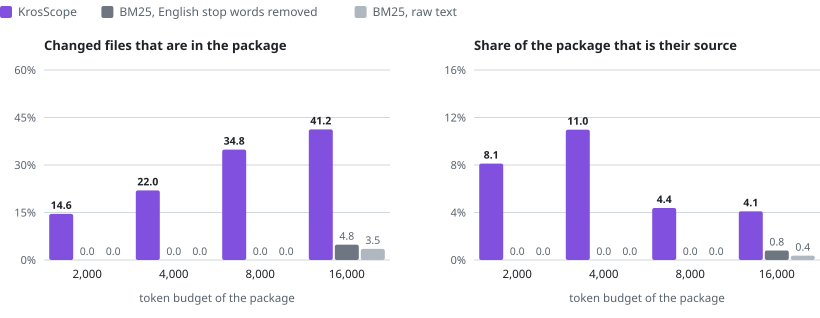
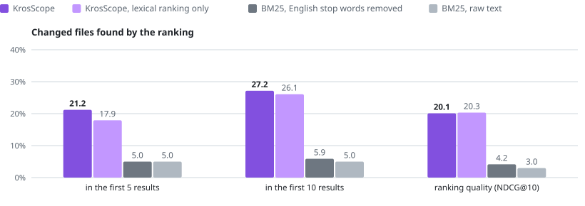

# Self benchmark

The [real-repository benchmark](real-repositories.md) applied to the history of this repository: the same
pipeline, the same metrics and the same gate. A task is the message of one KrosScope commit, and the answer key
is the source files that the commit changed.

<picture>
  <source media="(prefers-color-scheme: dark)" srcset="charts/self-context-budget.dark.svg">
  
</picture>

**It passes Tier 1 in both halves, and that says less than it seems.** On this repository BM25 returns
documentation, not source: 148 of the 190 files in its first ten results are Markdown pages, and its first result
is a documentation page in 18 of 19 tasks. The pages of this repository repeat the words of its commit
messages, so the margin measures a weak baseline more than a strong tool. The project's verdict still stands on
the two public repositories, where the gate is not met.

## Setup

| | |
|---|---|
| Repository | This one, at commit `70e2725` of `develop`: 45 commits |
| Tasks | 19, split by time into 9 for development and 10 for test |
| Commits left out | 26: 17 change more than eight source files, 8 change no source file that existed before, 1 has no parent |
| Size of a task | 4.1 changed source files on average, against 2.1 in the two public repositories |
| Size of the workspace | 78 to 2,416 files, as the repository grew |
| Freeze | [`selfbench-v1`](https://github.com/KrosStack/KrosScope/blob/main/benchmark/freezes/selfbench-v1.json), SHA-256 `b1699bd3664790982294ecb308ca0968a8c0f8ffb1fa9cc232324f51c5d0b605` |
| Environment | Windows 11, JDK 17, 8 October 2026, one run |

The freeze was written before anything was scored, and no code was changed between the two halves. Neither half
was used to develop anything, so the tables also give all 19 tasks together.

## Finding the files

<picture>
  <source media="(prefers-color-scheme: dark)" srcset="charts/self-localization.dark.svg">
  
</picture>

| Tasks | Method | Recall@5 | Recall@10 | NDCG@10 |
|---|---|---:|---:|---:|
| All 19 | KrosScope | 0.2119 | 0.2716 | 0.2012 |
| | KrosScope, lexical ranking only | 0.1794 | 0.2610 | 0.2033 |
| | BM25, English stop words removed | 0.0500 | 0.0588 | 0.0416 |
| | BM25, raw text | 0.0500 | 0.0500 | 0.0297 |
| Development half, 9 | KrosScope | 0.2574 | 0.3204 | 0.2753 |
| | KrosScope, lexical ranking only | 0.2296 | 0.2981 | 0.2831 |
| | BM25, English stop words removed | 0.1056 | 0.1241 | 0.0878 |
| | BM25, raw text | 0.1056 | 0.1056 | 0.0626 |
| Test half, 10 | KrosScope | 0.1710 | 0.2276 | 0.1345 |
| | KrosScope, lexical ranking only | 0.1343 | 0.2276 | 0.1314 |
| | BM25, English stop words removed | 0.0000 | 0.0000 | 0.0000 |
| | BM25, raw text | 0.0000 | 0.0000 | 0.0000 |

KrosScope finds about a quarter of the changed files in its first ten results. That is well below the 0.4650 of
the two public repositories, on tasks that are twice as large.

## The right files within a token budget

Each cell is KrosScope / BM25 with English stop words removed / BM25 on raw text, over all 19 tasks.

| Budget | Gold recall | Token precision |
|---:|---|---|
| 2,000 | 0.1456 / 0.0000 / 0.0000 | 0.0812 / 0.0000 / 0.0000 |
| 4,000 | 0.2198 / 0.0000 / 0.0000 | 0.1097 / 0.0000 / 0.0000 |
| 8,000 | 0.3485 / 0.0000 / 0.0000 | 0.0438 / 0.0000 / 0.0000 |
| 16,000 | 0.4125 / 0.0482 / 0.0351 | 0.0410 / 0.0080 / 0.0036 |

On the test half alone, gold recall is 0.1400, 0.1910, 0.3571 and 0.3971 and BM25 is zero at every budget. A
package of 16,000 tokens holds four in ten of the files that a change to KrosScope needed.

## Time

Medians over the 19 tasks, measured inside the benchmark process:

| Step | Median |
|---|---:|
| Fresh scan of the repository before the commit | 57.9 s |
| Update of the index to the commit | 28.4 s |
| Ranking the files for the task, all methods | 3.5 s |
| Compiling and scoring the context packages of the task, all methods and budgets | 9.5 s |

All five updates that were checked against a clean rebuild matched it.

## Reading it

- **The baseline is weak here.** See the top of this page. A repository with as much documentation as source is
  the easiest case for a tool that ranks source and the hardest for a ranking of all text.
- **Not independent.** The people who wrote the tool wrote these commits and their messages. Nothing was tuned on
  this history, but it is not evidence from someone else's code.
- **Nineteen tasks from four days of commits.** The intervals are wide. Against KrosScope's own lexical-only
  ranking the full ranking is inconclusive on every localization metric, with one significant gain in gold
  recall, at 16,000 tokens on the test half (0.3971 against 0.2962).
- **By level.** Recall@10 is 0.35 on the 11 tasks inside one module, 0.16 on the 6 across several modules and
  0.17 on the 2 across builds, which follows the [results by task level](task-levels.md).
- **Large commits are missing.** Seventeen commits change more than eight source files and are left out, as
  the protocol requires. Those are the changes where context would matter most.

## Reproducing

Clone this repository at the commit above, name the clone in a repositories file, and run the three commands of
the [historical commit evaluation](../benchmark.md#historical-commit-evaluation). The per-task records and the
source packages stay out of the repository; this page holds the aggregates.
