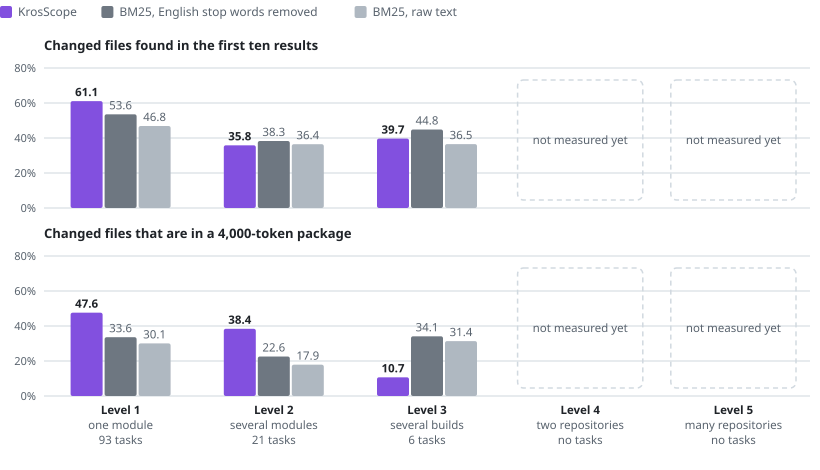

# Results by task level

The level of a task is how far its change reaches: one module, several modules, several builds, several
repositories. This page groups the 120 tasks of the [real-repository benchmark](real-repositories.md) by level
and reports the same metrics for each group. Nothing was run again; the per-task results of that benchmark were
grouped after the fact.

<picture>
  <source media="(prefers-color-scheme: dark)" srcset="charts/levels.dark.svg">
  
</picture>

## The levels

| Level | The files that the real commit changed lie in | Tasks | Status |
|---:|---|---:|---|
| 1 | One module | 93 | Measured |
| 2 | Several modules of one build | 21 | Measured |
| 3 | Several builds of one repository, such as an included build of convention plugins and the main build | 6 | Measured, too few tasks to conclude from |
| 4 | Two repositories | 0 | Not measured yet |
| 5 | A workspace of many repositories | 0 | Not measured yet |

The module of a file is its path up to `/src/`, or its directory when the path has no `src` directory. A build
is a directory with its own Gradle settings file. KrosScope can now index several repositories side by side in
one index (see [the decision](../decisions/0016-multi-repository-workspace.md)). The benchmark harness measures
tasks of levels 3 and 4 and groups its results by level, but no level 4 or 5 task has been measured yet, so
those rows hold no numbers and nothing is estimated. Six constructed level 4 tasks on a small fixture are
described in their own section below; they are not real-repository results and do not fill the row.

## How the levels are measured

- **Level and named flag.** A task carries its level and a flag that says whether its statement names the code
  to change. Both come from the task catalog, which derives the level from the files of the answer key.
- **Tasks over several repositories.** The runner clones each repository of a level 4 task into one workspace
  root, side by side, at the revision before the change, and indexes the root as one workspace. The answer
  key lists workspace paths, `<directory>/<path>`.
- **Same measures.** Localization and context packages are scored with the same methods, budgets and baselines
  as every other task, so a row of a level 4 group is comparable to a row of level 1.
- **Reporting.** The report groups results by level and by named or not named, separately for the development
  and the test half. The tables on this page are generated from that report. The commands are described under
  [historical commit evaluation](../benchmark.md#tasks-over-several-repositories-and-task-levels).
- **Few tasks.** A group of a handful of tasks describes those tasks. It carries no gate and no claim of
  significance, and a level is not presented as a result before a recorded run backs it.

## What it shows

- **Level 1: ahead.** KrosScope beats both BM25 baselines on every localization metric and on gold recall at
  every budget. It loses token precision at 8,000 and 16,000 tokens, as it does overall.
- **Level 2: mixed.** Its ranking is behind BM25 with English stop words removed on all three localization
  metrics. Its packages still hold more of the changed files at 2,000, 4,000 and 16,000 tokens.
- **Level 3: behind.** On six tasks of one repository it loses on almost every figure, most clearly in the
  packages of 2,000 and 4,000 tokens.
- **Size matters as much as reach.** Recall@10 falls from 0.63 for a change of one file to 0.30 for a change of
  four to seven files, and BM25 falls with it. KrosScope stays ahead on recall at every size.

## Numbers

Each cell is KrosScope / BM25 with English stop words removed / BM25 on raw text.

Localization:

| Level | Tasks | Changed files, mean | Recall@5 | Recall@10 | NDCG@10 |
|---:|---:|---:|---|---|---|
| 1 | 93 | 1.7 | 0.4876 / 0.4092 / 0.3582 | 0.6109 / 0.5356 / 0.4684 | 0.4352 / 0.3533 / 0.3136 |
| 2 | 21 | 3.4 | 0.2782 / 0.3604 / 0.3366 | 0.3582 / 0.3831 / 0.3644 | 0.2633 / 0.3252 / 0.2638 |
| 3 | 6 | 4.2 | 0.1587 / 0.3175 / 0.3175 | 0.3968 / 0.4484 / 0.3651 | 0.2976 / 0.3919 / 0.3575 |

Gold recall of a context package, the share of the changed files that it holds with source:

| Level | 2,000 tokens | 4,000 tokens | 8,000 tokens | 16,000 tokens |
|---:|---|---|---|---|
| 1 | 0.4043 / 0.2336 / 0.1933 | 0.4758 / 0.3358 / 0.3008 | 0.4964 / 0.4218 / 0.3761 | 0.6918 / 0.5275 / 0.4612 |
| 2 | 0.3366 / 0.1977 / 0.1235 | 0.3842 / 0.2255 / 0.1790 | 0.3905 / 0.3990 / 0.3457 | 0.5537 / 0.3990 / 0.3576 |
| 3 | 0.1310 / 0.2897 / 0.2897 | 0.1071 / 0.3413 / 0.3135 | 0.2619 / 0.3651 / 0.3651 | 0.4206 / 0.3651 / 0.3651 |

Token precision of a context package, the share of its tokens that is source of the changed files:

| Level | 2,000 tokens | 4,000 tokens | 8,000 tokens | 16,000 tokens |
|---:|---|---|---|---|
| 1 | 0.1750 / 0.1564 / 0.1388 | 0.1412 / 0.1284 / 0.1242 | 0.0395 / 0.0963 / 0.0939 | 0.0366 / 0.0644 / 0.0594 |
| 2 | 0.1588 / 0.2019 / 0.0670 | 0.1771 / 0.1570 / 0.0570 | 0.0328 / 0.1064 / 0.0653 | 0.0363 / 0.0585 / 0.0441 |
| 3 | 0.0823 / 0.2649 / 0.2649 | 0.1163 / 0.2638 / 0.2147 | 0.0544 / 0.1503 / 0.1503 | 0.0612 / 0.0751 / 0.0751 |

By the number of files that the commit changed, over all levels:

| Changed files | Tasks | Recall@10 | Gold recall at 4,000 tokens | Token precision at 4,000 tokens |
|---|---:|---|---|---|
| 1 | 62 | 0.6290 / 0.5806 / 0.5161 | 0.5161 / 0.3871 / 0.3387 | 0.1137 / 0.1022 / 0.0981 |
| 2 or 3 | 37 | 0.5811 / 0.5270 / 0.4595 | 0.4550 / 0.3018 / 0.2928 | 0.1795 / 0.1840 / 0.1642 |
| 4 to 7 | 21 | 0.2958 / 0.2402 / 0.2096 | 0.1966 / 0.1354 / 0.0849 | 0.1837 / 0.1749 / 0.0893 |

## Level 4 on the workspace fixture

The rows of level 4 above stay empty because no real commit over two repositories has been measured. Separately,
six constructed tasks over the TaskTide [workspace fixture](../benchmark.md#level-4-tasks-on-the-workspace-fixture)
were run, each needing edits in two of its repositories: a Maven coordinate dependency, a JAR file dependency, a
C++ JNI library, a Rust JNI library, an OpenAPI operation and a web bundle. Three statements name the code to change
and three do not. The fixture is small, with a few dozen files, and the tasks were written for it, so these figures
describe only these six tasks. They are not real-repository results, they carry no gate, and they support no claim
about KrosScope against text search. In the ranking, BM25 leads on recall@10 and NDCG@10; in the packages,
KrosScope holds one more gold item than BM25 from 4,000 tokens on, on one task.

Each cell is KrosScope / BM25 with English stop words removed / BM25 on raw text.

Localization:

| Set | Tasks | Recall@5 | Recall@10 | NDCG@10 |
|---|---:|---|---|---|
| All tasks | 6 | 0.6111 / 0.5972 / 0.6528 | 0.7361 / 0.8333 / 0.7778 | 0.6773 / 0.7053 / 0.7122 |
| Named | 3 | 0.8333 / 0.9167 / 0.9167 | 0.9167 / 1.0000 / 1.0000 | 0.8913 / 0.9850 / 0.9816 |
| Not named | 3 | 0.3889 / 0.2778 / 0.3889 | 0.5556 / 0.6667 / 0.5556 | 0.4633 / 0.4257 / 0.4428 |

Gold recall of a context package:

| Set | Tasks | 2,000 tokens | 4,000 tokens | 8,000 tokens | 16,000 tokens |
|---|---:|---|---|---|---|
| All tasks | 6 | 0.9333 / 0.9333 / 0.9333 | 0.9667 / 0.9333 / 0.9333 | 0.9667 / 0.9333 / 0.9333 | 0.9667 / 0.9333 / 0.9333 |
| Named | 3 | 1.0000 / 1.0000 / 1.0000 | 1.0000 / 1.0000 / 1.0000 | 1.0000 / 1.0000 / 1.0000 | 1.0000 / 1.0000 / 1.0000 |
| Not named | 3 | 0.8667 / 0.8667 / 0.8667 | 0.9333 / 0.8667 / 0.8667 | 0.9333 / 0.8667 / 0.8667 | 0.9333 / 0.8667 / 0.8667 |

Token precision of a context package:

| Set | Tasks | 2,000 tokens | 4,000 tokens | 8,000 tokens | 16,000 tokens |
|---|---:|---|---|---|---|
| All tasks | 6 | 0.1437 / 0.1457 / 0.1442 | 0.1335 / 0.1345 / 0.1315 | 0.1033 / 0.1345 / 0.1315 | 0.1033 / 0.1345 / 0.1315 |
| Named | 3 | 0.1610 / 0.1612 / 0.1614 | 0.1446 / 0.1476 / 0.1462 | 0.1069 / 0.1476 / 0.1462 | 0.1069 / 0.1476 / 0.1462 |
| Not named | 3 | 0.1263 / 0.1302 / 0.1270 | 0.1225 / 0.1215 / 0.1168 | 0.0997 / 0.1215 / 0.1168 | 0.0997 / 0.1215 / 0.1168 |

## Limits

- **Grouped after the fact.** The levels were not part of the frozen protocol. The figures describe; they carry
  no gate, no confidence interval and no claim of significance.
- **Both halves pooled.** The table uses all 120 tasks, because the held-out half alone has 48, 11 and 1 tasks
  at levels 1 to 3. The development half was used to develop the packing at 2,000 and 4,000 tokens, so those
  columns flatter KrosScope somewhat. On the held-out half alone the direction is the same, except that at
  level 2 KrosScope is narrowly ahead on recall@10 (0.355 against 0.349).
- **Few tasks above level 1.** Level 2 has 21 tasks and level 3 has six, all six from Now in Android.
- **The level comes from the answer key.** It says where the commit changed files, not what a developer had to
  read to make the change.
- **Two freezes.** As on the benchmark page, the columns at 2,000 and 4,000 tokens come from the freeze
  `realrepos-v2` and the rest from `realrepos-v1`.
